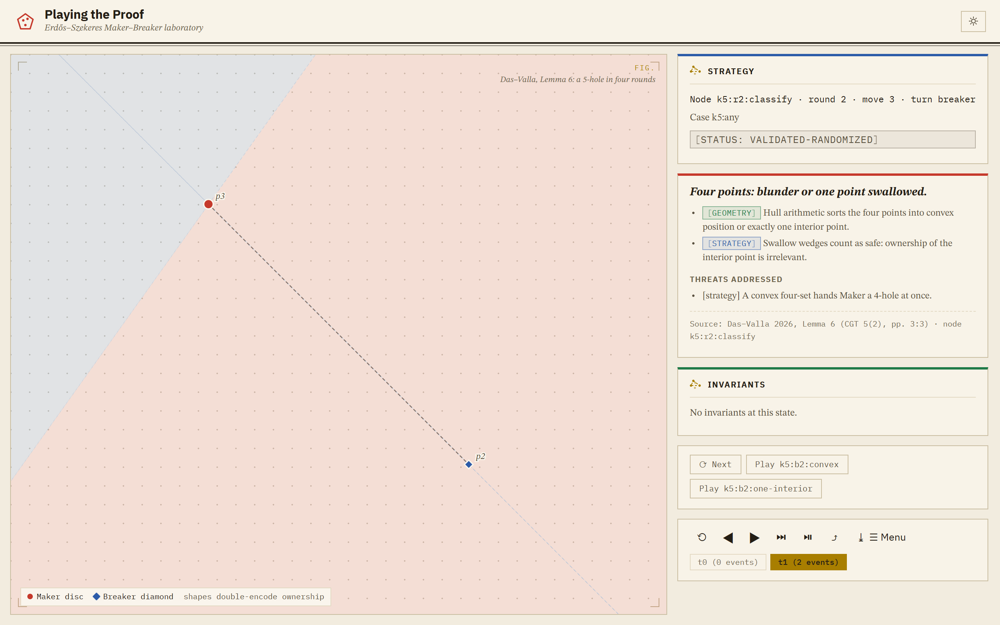
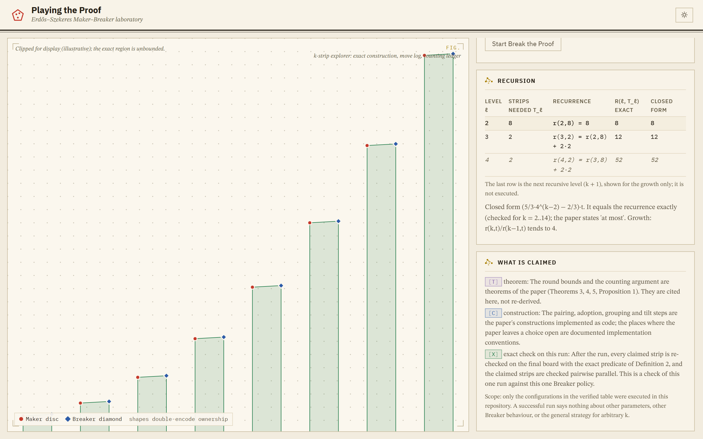
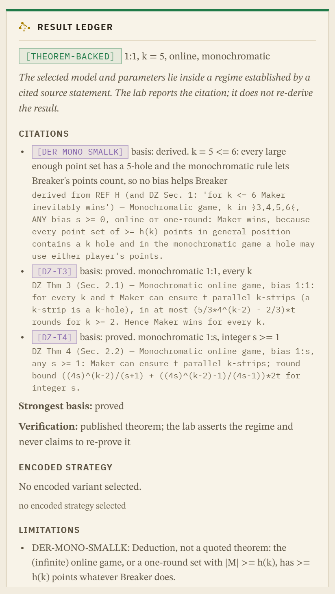

# Playing the Proof

**An Interactive Laboratory for Erdős–Szekeres Maker–Breaker Strategies**

Scientific Visualization course project by Shourya Sarkar (instructor: Raghavendra GS), November 2026.

Live application: https://playing-the-proof.pages.dev/

Repository: https://github.com/shouryasarkar713/playing-the-proof

*The game is the medium; the geometric proof is the subject.*

## Overview

In the Erdős–Szekeres Maker–Breaker game two players alternately place points in the plane, Maker trying to complete an empty convex k-gon (a *k-hole*) and Breaker trying to prevent it. The winning strategies in the literature are geometric constructions whose correctness rests on case analyses and counting arguments. This project lets you *play* those constructions: you step through a published strategy, play Breaker against the encoded Maker, and see at each move which geometric fact makes the strategy work, together with an exact check that the fact holds on the board in front of you. A geometric kernel over exact rational arithmetic (bigint fractions, no floating point) decides every predicate.

The software demonstrates and checks encoded constructions; it does **not** re-prove the published theorems, and it makes no claim to advance the Erdős–Szekeres problem. The report separates theorems, exact computation, finite exhaustive checks, randomized experiments and performance measurements.



## Capabilities

- **Proof mode** for k = 5, 6, 7 (Das–Valla Lemmas 6, 7, 8) and a **guided walkthrough for k = 8** (Lemma 9; some branches are not encoded and end as typed *uncovered* terminals): guided stepping with sample replies per case, autoplay, a timeline with branching, tier-labelled explanations and live invariant lamps.
- **Break the Proof**: play Breaker freely against the encoded Maker, with threat previews, classification of every reply, and honest *uncovered* terminals when you leave the encoded domain.
- **Sandbox**: free placement in either colour, typed exact coordinates, hole browsing, hole counts, the Overmars-29 preset, and a switch between the monochromatic and bichromatic winning rule.
- **k-strip explorer**: an executable form of the recursive k-strip strategy of Džuklevski et al. (Theorems 3, 4, 5) with cost estimates, cones, pairing, a counting ledger, three Breaker policies and per-run exact verification, for a table of verified configurations.
- **Parameter Laboratory**: classifies any (model, k, bias, rule) configuration as *theorem-backed*, *experimental* or *not covered*, with citations and limitations, plus a bounded simulation labelled as observation only.
- **Replays**: export, fork, resume and import sessions; imports are re-validated by re-running the engine and checking the state-hash chain. Explorer and laboratory experiments have a separate re-executable file format.



## Mathematical summary

A k-hole of a point set in general position is a k-subset in convex position whose hull contains no other point. Maker places the (2r−1)-st point in round r. The implemented guided constructions reach a 5-hole from 7 points (round 4), a 6-hole from 11 points (round 6) and a 7-hole from 15 points (round 8). The recursive k-strip strategy yields t parallel k-strips in r(k,t) rounds, with r(k,t) = r(k−1,4t) + 2t, whose closed form is (5/3·4^(k−2) − 2/3)·t for k ≥ 2. The bichromatic rule requires hole vertices to be Maker's points, with Breaker's points acting as blockers only. See [docs/PROJECT_REPORT.md](docs/PROJECT_REPORT.md) for details and sources.

## Modules

`geometry` (exact kernel), `game` (state, legality, modes, hashing), `strategy` (declarative strategy language and the k = 5, 6, 7, 8 definitions), `verification` (node checks, cell checks, twin checkers), `explain` (claim tiers, claim linter, help text), `engine` (pure reducer), `session` (the only mutable module), `replay` (formats, validation), `viz` (scene descriptors, projection), `ui` (modes, panels, timeline), plus the leaf modules `kstrip` (k-strip core) and `lab` (parameter laboratory).

## Architecture

Layers import strictly downward; `kstrip` imports `geometry` only, `lab` imports `geometry` and `game` only, and only `ui` may import either. The rules are enforced by lint zones (`eslint.config.js`) and an architecture test that reads the sources. Pure layers contain no DOM, timer, storage or network code, floating-point `Math.*` appears only in `viz/projection.ts`, and the orientation formula is written only in `geometry/predicates.ts`. A diagram is in [docs/figures/architecture.svg](docs/figures/architecture.svg).

## Tech stack

TypeScript (strict), Vite, zero runtime dependencies. Development tooling (from `package.json`): TypeScript 6.0.3, Vite 8.3.8, Vitest 5.1.1 with `@vitest/coverage-v8` 5.1.1, ESLint 10.15.0, `typescript-eslint` 8.73.0, `eslint-plugin-import-x` 4.18.1, Prettier 3.9.9, `fast-check` 4.10.2, `jsdom` 29.1.1.

## Requirements

Node 22 and npm. Python 3 (standard library) is needed only for the independent oracle scripts; PyMuPDF is needed only to regenerate the report PDF.

## Install, run, build

```
npm ci
npm run dev        # development server
npm run build      # type check + production build into dist/
npm run preview    # serve the production build
```

## Verification

| Command | Purpose |
|---|---|
| `npm run verify` | type check, lint (including architecture zones), default tests, production build |
| `npm run test:slow` | slow tier: randomized game runs, cell-exhaustive k = 7 gate, Overmars-29 (about an hour) |
| `npm run coverage` | default tests with coverage, then per-directory line gates |
| `npm run audit:replays` | transaction-chain and hash-continuity walk over the sample replays in `data/replays/` |
| `python -I scripts/audit/gen_fixtures.py` | regenerate the differential fixtures from the independent Python oracle |
| `python -I scripts/audit/kstrip_oracle.py` | regenerate the k-strip oracle fixture |

`scripts/audit/overmars_check.py` needs the source paper and companion data files that are not part of this repository and cannot run from a clean checkout. See [docs/VERIFICATION.md](docs/VERIFICATION.md) for what each command checks and for measured durations.

## Keyboard controls

Proof: Space autoplay, Left/Right step, R restart, 1–4 overlays, C case map, B note branch point, M/Escape menu. Break the Proof: the same without Space. k-strip explorer: Left/Right step the log, Space play, R restart, M/Escape menu. Parameter Laboratory: M/Escape menu. Sandbox: mouse and typed coordinates, no shortcuts. Typing in a field suspends shortcuts.



## Supported features and known limitations

- Interactive proofs exist for **k = 5, 6 and 7**. **k = 8 is a guided, partly verified walkthrough only**: it starts from a bare 7-point heptagon; some branches are not encoded and end as typed *uncovered* terminals; the exhaustive gate was not completed (Maker's A1 was swept over every B0 cell of five heptagons with no uncovered outcome, but A3, the B3 dichotomy and A4 are only sampled or bounded). For k = 7 and 8 a *Reply classes* panel labels each branch Interactive, Guided or Not encoded before it is entered. Promotion from k = 7 to k = 8 is not offered. See the report, section 6.4, and `docs/K8_GATE.md`.
- The k = 6 and k = 7 searches for Maker's escape point are bounded (play window, halving and candidate limits); a miss ends in a typed *uncovered* terminal, never a silent guess. Strategy badges read *validated-randomized*: exact per-move checks and finite validation, not a proof.
- The k = 7 case analysis is a reconstruction of a proof sketch, validated over a large finite family of configurations (see the report), not proved.
- The k-strip explorer executes only the verified configurations in its table; other parameters are shown as cost estimates. The recursion is implemented as an executor over the exact k-strip primitives and is also written as a validated declarative specification with an interpreter that reproduces the executor's logs on every verified configuration (`docs/KSTRIP_SPEC.md`); the specification lives beside the strategy engine, not inside it.
- Bias 1:s is an engine capability (Maker first; after Maker's r-th point Breaker has floor(s·r) points; a project convention, no theorem inferred) with a Sandbox control and replay format v4; guided Proof and Break-the-Proof strategies refuse bias other than 1:1, the k-strip explorer has its own biased executor for its verified configurations, and the laboratory simulation is separate. The bichromatic rule is supported in the Sandbox, hole detection, the k-strip explorer and the laboratory, but not by the main Proof and Break-the-Proof strategies (`docs/BIAS.md`, `docs/BICHROMATIC.md`).
- Requirement-by-requirement status against the proposal: [docs/REQUIREMENTS_MATRIX.md](docs/REQUIREMENTS_MATRIX.md).
- Replays are validated play records: the hash is a non-cryptographic checksum over game state.
- Not tested with screen readers, non-Chromium browsers or real mobile devices.
- A participant study and a demonstration video are **not part of this release**.

## Research references

1. A. Džuklevski, D. Pálvölgyi, A. Pokrovskiy, C. D. Tóth, T. Valla, L. Verlinde, *Erdős–Szekeres Maker–Breaker Games*, Theoretical Computer Science 1077 (2026), Article 115999, DOI 10.1016/j.tcs.2026.115999 (preprint arXiv:2505.15366).
2. A. K. Das, T. Valla, *On Erdős–Szekeres Maker–Breaker games*, Computing in Geometry and Topology 5(2), Article 3, 2026, DOI 10.57717/cgt.v5i2.73.
3. O. Aichholzer et al., *Erdős–Szekeres-type games*, Proc. 35th EuroCG, 2019, pp. 23:1–23:7 (extended abstract).
4. M. J. H. Heule, M. Scheucher, *Happy Ending: An Empty Hexagon in Every Set of 30 Points*, TACAS 2024, DOI 10.1007/978-3-031-57246-3_5 (preprint arXiv:2403.00737).
5. B. Subercaseaux et al., *Formal Verification of the Empty Hexagon Number*, ITP 2024, LIPIcs 309, Article 35, DOI 10.4230/LIPIcs.ITP.2024.35 (preprint arXiv:2403.17370).
6. P. Kolipaka, S. Govindarajan, *Two player game variant of the Erdős–Szekeres problem*, DMTCS 15(3), 2013, 73–100, DOI 10.46298/dmtcs.620.

## Documentation

- Report: [docs/PROJECT_REPORT.pdf](docs/PROJECT_REPORT.pdf) and [docs/PROJECT_REPORT.md](docs/PROJECT_REPORT.md)
- [docs/KSTRIP.md](docs/KSTRIP.md), [docs/LAB_REGIMES.md](docs/LAB_REGIMES.md), [docs/K7_GATE.md](docs/K7_GATE.md), [docs/BICHROMATIC.md](docs/BICHROMATIC.md), [docs/EXPERIMENT_REPLAY.md](docs/EXPERIMENT_REPLAY.md)

## License

No license has been selected for this repository. Unless stated otherwise, all rights are reserved by the author. The Das–Valla paper is published under CC BY 4.0; no paper figure is reproduced in the application.
