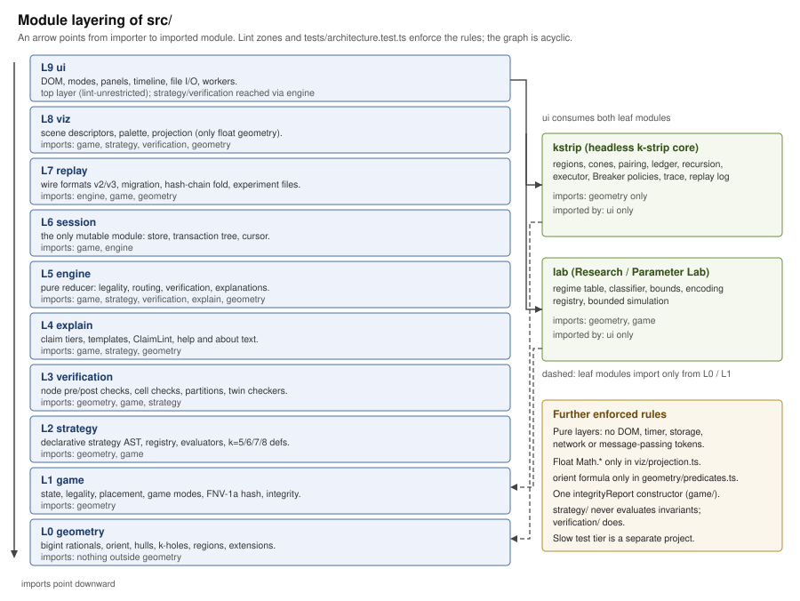
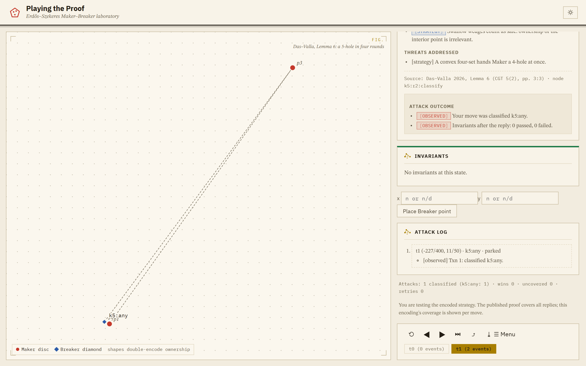
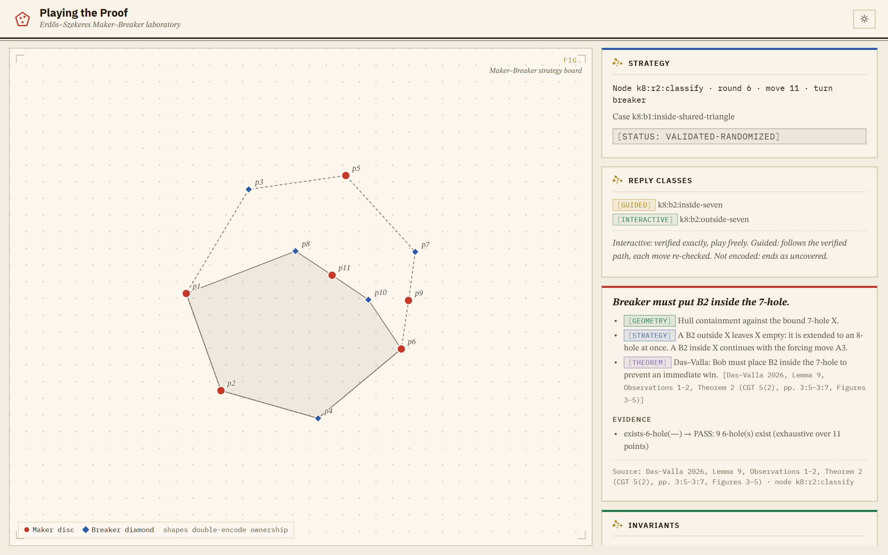
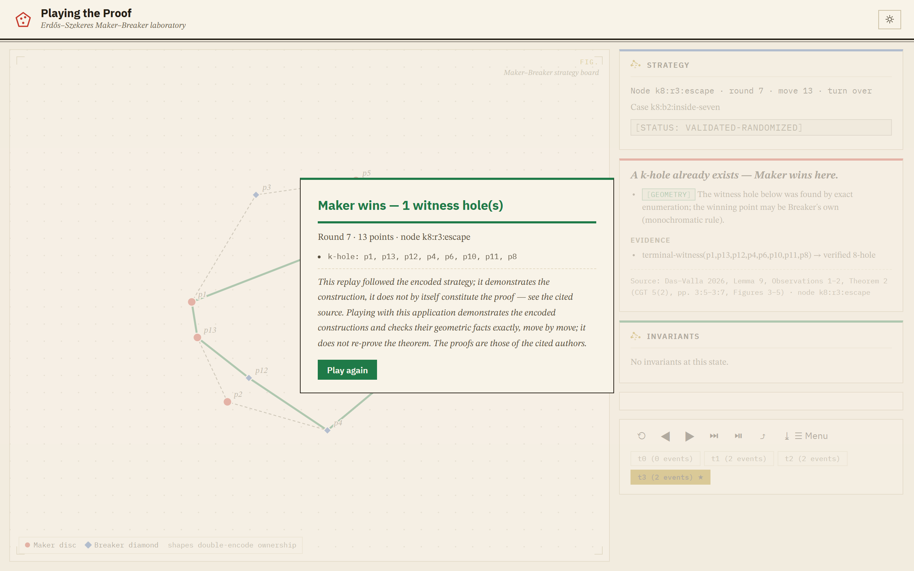
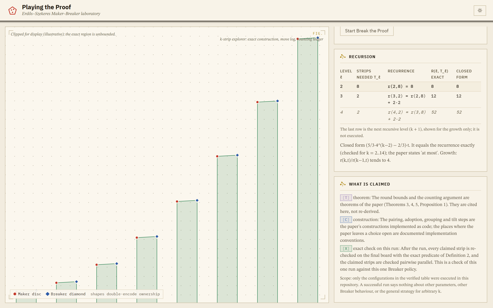
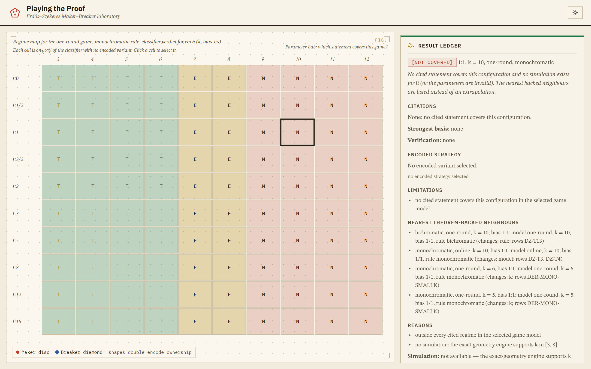
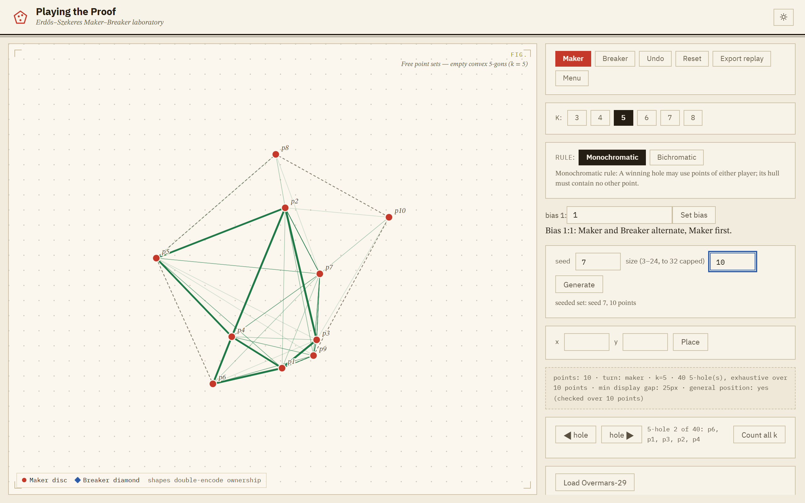
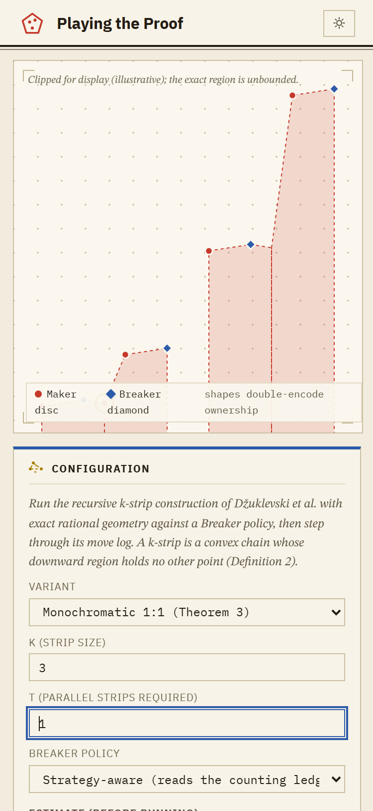

# Playing the Proof: An Interactive Laboratory for Erdős–Szekeres Maker–Breaker Strategies

- **Student:** Shourya Sarkar
- **Course:** Scientific Visualization
- **Instructor:** Raghavendra GS
- **Date:** November 2026
- **Repository:** https://github.com/shouryasarkar713/playing-the-proof

*The game is the medium; the geometric proof is the subject.*

---

## Abstract

The Erdős–Szekeres problem asks how many points in general position force a convex polygon, and its empty variant asks for a convex polygon with no other point inside (a *k-hole*). Recent work turns this Ramsey-type question into a two-player Maker–Breaker game in which the players alternately place points, Maker trying to complete a k-hole and Breaker trying to prevent it. The winning strategies in the literature are constructive and geometric, and their correctness rests on case analyses and counting arguments that are normally read rather than executed.

This report describes *Playing the Proof*, a browser-based laboratory in which those constructions are played instead of animated. A geometric kernel over exact rational arithmetic (bigint numerators and denominators) decides every predicate the strategies rely on, so that each claim shown on screen, such as "these two pentagons are 5-holes meeting exactly in a triangle", is checked on the actual board before it is presented. The system contains guided and adversarial modules for the published constructions with k = 5, 6 and 7, a guided walkthrough of the k = 8 construction, an executable explorer for the recursive k-strip strategy of Džuklevski et al., which is also written as a validated declarative specification, a parameter laboratory that classifies any game configuration as theorem-backed, experimental or not covered, a free sandbox that supports both the monochromatic and the bichromatic winning rule, and a replay format whose state-hash chain lets sessions be re-validated.

The report is explicit about what is established by what. Published theorems are cited, not re-proved; computations are exact but finite; the k = 7 case analysis is validated over a large finite family of configurations and by randomized play, not proved; the k = 8 construction is available only as a guided walkthrough whose exhaustive gate was not completed; and the k-strip recursion is also available as a validated declarative specification run by a separate interpreter. No new theorem is claimed and no claim is made about advancing the Erdős–Szekeres problem itself.

---

## 1 Introduction

Many arguments in discrete geometry are easy to follow line by line and hard to hold in the head all at once. The winning strategies for Maker in the Erdős–Szekeres Maker–Breaker game are of this kind. A typical proof says that after Breaker's reply some pair of 4-holes must remain, that Maker can then place a point creating two 5-holes that overlap in one triangle, and that whatever Breaker does next, at least one 5-hole survives. Each sentence is a geometric claim about an arrangement that depends on where the points actually are. A reader is asked to believe the claim for all arrangements, usually from a single figure.

This project takes the position that the **game is the medium and the geometric proof is the subject**. The game supplies motion, turns and consequences; the proof supplies the content. Three levels of presentation can be distinguished.

*An exposition* explains a proof with static or animated figures. The reader watches but cannot probe the claim.

*A game* lets the user make moves against an opponent, but its rules and feedback concern winning and losing, not the structure of a proof. A user may win without learning why the strategy works.

*A playable proof*, the goal here, lets the user step through a published construction, choose among the branches the proof distinguishes, play Breaker against the encoded Maker, and see at every move which geometric fact is responsible for the outcome, together with an exact check that this fact holds on the board at hand. When the user's move leaves the territory the encoding covers, the system says so, instead of silently improvising.

Making this honest requires separating three things that are easily conflated: what a published theorem asserts, what the software computes exactly on a particular board, and what the software merely samples. Much of the architecture described below exists to keep those categories apart, and the evaluation chapter reports them separately.

The remainder of the report is organised as follows. Section 2 recalls the mathematics. Section 3 states objectives and scope. Section 4 presents the architecture, and Section 5 the exact geometric engine and its verification layer. Sections 6 to 10 describe the interactive proof modules, the general k-strip explorer, the parameter laboratory, the strategy-aware Maker and Breaker, and the bichromatic and biased game support. Section 11 describes the interaction design, Section 12 the evaluation, and Section 13 the limitations. The appendix lists setup, controls, reproduction commands and a mapping from features to the checks that cover them.

---

## 2 Mathematical Background

### 2.1 Convex position, holes and general position

A finite point set $S \subset \mathbb{R}^2$ is in *general position* if no three of its points are collinear (and, for the game, no two coincide). A subset $H \subseteq S$ with $|H| = k$ is in *convex position* if its points are the vertices of a convex $k$-gon. It is a *k-hole* of $S$ if in addition $\operatorname{conv}(H) \cap S = H$, that is, no other point of $S$ lies inside the polygon [1]. Write $h(k)$ for the least $n$ such that every $n$-point set in general position contains a $k$-hole. Classical results, as summarised in [1] and [4], give $h(3)=3$, $h(4)=5$, $h(5)=10$ and, by a computer-assisted proof, $h(6)=30$; Horton's construction of arbitrarily large sets without 7-holes gives $h(k)=\infty$ for $k \ge 7$. A machine-checked formalisation of $h(6)=30$ in the Lean prover is reported in [5]. These values matter to the project in two ways: they explain why Maker cannot lose the games for $k \le 6$ however large the Breaker bias, and they supply a 29-point set without a 6-hole used as a sandbox preset (Section 11.1).

All predicates in this work reduce to a single primitive, the orientation of a triple,

$$\operatorname{orient}(a,b,c) = \operatorname{sign}\big((b_x-a_x)(c_y-a_y)-(b_y-a_y)(c_x-a_x)\big) \in \{-1,0,+1\},$$

where $+1$ means that $c$ lies to the left of the directed line $a \to b$. A set is in general position exactly when no triple has orientation $0$ and no two points coincide. Convex position, hulls, emptiness and the strip regions of Section 2.4 are all computed from orientation signs.

### 2.2 The Maker–Breaker game

In the Erdős–Szekeres Maker–Breaker game two players, Maker and Breaker, alternately place a point of the plane, Maker first, subject to the set remaining in general position. Maker wins if a $k$-hole ever exists; Breaker wins if she can prevent that indefinitely [1, 2]. In the *monochromatic* game the points of both players may form the winning hole. In the *bichromatic* game the set is $S = M \cup B$, a winning $k$-hole must consist of Maker points only, and Breaker's points count solely as blockers in its interior [1]. Aichholzer et al. introduced these games within a taxonomy that also contains Maker–Maker and Avoider–Avoider versions [3]; the Avoider–Avoider game for $k=5$ was studied by Kolipaka and Govindarajan [6].

Maker places the $(2r-1)$-st point in round $r$, so a win in round $r$ uses $2r-1$ points. Das and Valla show that Maker wins the monochromatic game for every $k \le 8$, with explicit round counts: a 5-hole from 7 points in round 4, a 6-hole from 11 points in round 6, a 7-hole from 15 points in round 8, and an 8-hole from 25 points [2]. Džuklevski et al. prove that in the monochromatic game Maker wins for every $k$, even when Breaker may place $s$ points per round for any constant $s \ge 1$; that in the bichromatic game Maker wins for every constant bias $0 \le s < 2$ and every $k \ge 3$; and that Breaker wins the bichromatic game when $k \ge 8$ and the bias is $1\!:\!12$ [1].

### 2.3 Bias

A bias $1\!:\!s$ means that Breaker places $s$ points for each Maker point. The *online* game interleaves moves; the *one-round* (offline) game has Maker place all of her points first and Breaker answer afterwards. The two models are not interchangeable. Breaker wins the bichromatic one-round game at bias exactly $1\!:\!2$ for all $k$ and $n$ [1, Proposition 7], whereas for the online game a bias of 2 lies in a range that [1] leaves open. The project therefore treats the model as a parameter and never transfers a statement from one model to the other.

### 2.4 k-strips, extension cones, pairing and counting

The central device of [1] is the *k-strip*. For a point set $S$ and a halfline direction $\vec v$, a set $P \subseteq S$ of $k$ points in convex position is a $k$-strip with respect to $S$ if the unbounded region

$$C = \operatorname{conv}(P) + \vec v$$

satisfies $\operatorname{int}(C) \cap S = \emptyset$ and $\partial C \cap S = P$. Informally, a $k$-strip is a $(k+1)$-hole with one vertex at infinity. Two $k$-strips are *parallel* if they use the same direction and their regions are disjoint. For the downward direction a $k$-strip is a $k$-cap in the sense of Erdős and Szekeres. Every $k$-strip is a $k$-hole, so many parallel strips give a hole.

For a downward strip $P=\{s_1,\dots,s_k\}$ sorted by $x$, $k \ge 2$, the *extension cones* $C^-$ and $C^+$ are swept by rotating the downward halfline at $s_1$ clockwise and the one at $s_k$ counter-clockwise until it reaches the line through the first two (respectively last two) vertices or passes through a point of $S$. Any point of $S$ in the closure of either cone extends $P$ to a $(k+1)$-strip.

The recursive strategy builds parallel $k$-strips from parallel $(k-1)$-strips by *pairing*. Given $4t$ parallel $(k-1)$-strips ordered left to right, Maker pairs consecutive strips $S_{2j-1}, S_{2j}$ and, in the gap between them, picks a vertical line $\ell_j$ and a point $p_j$ on the downward halfline $\ell_j \cap C^+_{2j-1} \cap C^-_{2j}$. The point $p_j$ creates two *candidate* strips, $S_{2j-1} \cup \{p_j\}$ and $S_{2j} \cup \{p_j\}$, with candidate regions that have disjoint interiors and share only the halfline below $p_j$. While Maker makes her $2t$ placements, Breaker makes $2t$ of her own. A Breaker point on a candidate's boundary replaces the corresponding vertex (the *adoption* rule), which can only shrink the region. By pigeonhole, at most $t$ of the $2t$ pairs can receive two or more Breaker points in their interiors, so at least $t$ pairs have a surviving candidate, and these yield $t$ parallel $k$-strips [1, Theorem 3]. This is a *counting* argument: it does not predict where Breaker plays, only that she cannot afford to disturb enough pairs.

### 2.5 Recursion and round counts

Let $r(k,t)$ be the number of rounds after which Maker can guarantee $t$ parallel $k$-strips. The base cases are $r(1,t) = t/2$ and $r(2,t)=t$, and the pairing step gives

$$r(k,t) = r(k-1,\,4t) + 2t \qquad (k \ge 3).$$

Unrolling the recurrence is an elementary calculation, reproduced here only to show that the closed form is an equality; for $k\ge2$,

$$r(k,t) = r(2,4^{k-2}t) + 2t\sum_{j=0}^{k-3}4^{j} = 4^{k-2}t + 2t\,\frac{4^{k-2}-1}{3} = \Big(\tfrac{5}{3}\,4^{k-2}-\tfrac{2}{3}\Big)t.$$

The paper states the bound as "at most" in Theorem 3 and writes the closed form with an equality in its proof [1]. For the biased game with integer $s \ge 1$ the recurrence becomes $r(k,t) = r(k-1,4st)+2t$ for $k \ge 3$ only (at $k=2$ it would give $r(1,4st)+2t \neq r(2,t)$), with closed form, valid for $k \ge 2$,

$$r(k,t) = \Big(\frac{(4s)^{k-2}}{s+1} + \frac{(4s)^{k-2}-1}{4s-1}\Big)\,2t,$$

which reduces to the monochromatic one at $s=1$ [1, Theorem 4]. The bichromatic strategy of [1, Theorem 5] additionally tilts the common direction so that Breaker's points, which can no longer be adopted, avoid the candidates.

No result in this section is new; the report cites them and, where the software executes a construction, says exactly which parts are the authors' and which are implementation choices.

---

## 3 Objectives and Scope

The project proposal set the goal of making the constructive strategies explorable while keeping every displayed geometric claim honest. Concretely, the system aims to

1. play the published Maker strategies for $k=5$, $6$ and $7$ as guided proofs and as adversarial exercises in which the user plays Breaker, and walk through the $k=8$ construction in a guided form;
2. present the recursive k-strip strategy of [1] as an executable object whose pairing, adoption, counting and recursion steps are visible and whose claimed strips are re-checked exactly;
3. state, for any game configuration the user selects, whether a published theorem covers it, whether only a bounded simulation exists, or whether neither does, with the citation and its strength;
4. support both winning rules and exact rational bias, with explicit rules for what is and is not covered;
5. make sessions replayable and verifiable; and
6. present all of this with explanations whose wording does not claim more than the underlying check establishes.

The scope is deliberately bounded. The software is an *interactive laboratory*, not a theorem prover and not a solver for the game. It does not search for strategies, does not claim optimality of any Breaker policy, and does not prove that a construction works for all Breaker behaviour. The $k=8$ construction is offered as a guided walkthrough only, with the verification gaps stated in Section 6.4; the full branching $k=8$ game is not claimed. A participant study and a demonstration video are not part of this release version (Section 13).

---

## 4 System Architecture

### 4.1 Technology

The application is a TypeScript single-page program built with Vite, with **zero runtime dependencies**: the shipped bundle contains only project code, and fonts are self-hosted. Development tooling consists of TypeScript 6.0.3, Vite 8.3.8, Vitest 5.1.1 (with the V8 coverage provider), ESLint 10.15.0 with `typescript-eslint` 8.73.0 and `eslint-plugin-import-x` 4.18.1, Prettier 3.9.9, `fast-check` 4.10.2 for property tests, and `jsdom` 29.1.1 for interface tests. The compiler runs in strict mode with `noUncheckedIndexedAccess` and `exactOptionalPropertyTypes`. Node 22 and npm are required.

### 4.2 Layered modules

The source is divided into twelve modules whose import relations are fixed by lint rules and by an architecture test that reads the source files (`eslint.config.js`, `tests/architecture.test.ts`). Ten of them form a stack in which every module may import only from strictly lower layers; two further modules, `kstrip` and `lab`, are leaves that depend only on the lowest layers and may be imported only by the interface.



| Module | Role | May import |
|---|---|---|
| `geometry` (L0) | exact rationals, orientation, hulls, k-hole search, polygons and arrangements, growth constructions | nothing outside itself |
| `game` (L1) | state model, legality, placement, game modes, state hash, integrity values | geometry |
| `strategy` (L2) | declarative strategy language, registry, evaluators, strategy definitions for k = 5, 6, 7, 8 | geometry, game |
| `verification` (L3) | pre/post-condition checks, cell and partition checks, twin checkers | geometry, game, strategy |
| `explain` (L4) | explanation tiers, templates, claim linter, help and about text | game, strategy, geometry |
| `engine` (L5) | pure reducer, routing, promotion, read-only describers | game, strategy, verification, explain, geometry |
| `session` (L6) | in-memory store, transaction tree, cursor (the only mutable module) | game, engine |
| `replay` (L7) | wire formats, migration, validation fold, experiment files | engine, game, geometry |
| `viz` (L8) | scene descriptors, palette, projection | game, strategy, verification, geometry |
| `ui` (L9) | DOM, modes, panels, timeline, file input and output, workers | unrestricted by lint; by convention reaches strategy and verification through `engine` |
| `kstrip` | headless k-strip core, including the declarative specification in `kstrip/spec` | geometry only; imported by ui only |
| `lab` | parameter laboratory | geometry, game only; imported by ui only |

Together the modules comprise roughly 31,700 lines of TypeScript in `src/` and 28,000 in `tests/`. Further rules are enforced mechanically. The pure layers may not contain tokens that denote effects (document access, timers, storage, network or message passing). Floating-point operations (`Math.*`) may appear only in `viz/projection.ts`, the single place where world and screen coordinates meet, and the orientation formula may be written only in `geometry/predicates.ts`. There is exactly one constructor of integrity reports. The strategy layer is forbidden from evaluating invariants; evaluation belongs to `verification`. The slow test tier is a separate project excluded from the default verification command.

### 4.3 Data flow

A move enters through the interface as a user action. The engine's reducer turns it into an *intent* (a candidate placement or a typed rejection), applies the legality ladder, detects a win, routes through the active strategy (classifying Breaker's reply, binding named points, computing Maker's answer), runs the declared pre- and post-conditions through the verification layer, assembles an explanation, and returns a result without side effects. The session layer then commits the result as a *transaction* in an append-only tree and the interface renders the new state. Because the reducer is pure and deterministic, replaying the recorded actions reproduces the same states, which is what makes the replay format of Section 5.4 verifiable.

The scene that reaches the screen is a list of keyed descriptors produced by `viz`; the interface patches the SVG from it. Exact rationals never become floating-point numbers except in `viz/projection.ts`, and screen coordinates return to geometry only by quantisation to an exact rational on a fixed grid (*the one-way rule*).

---

## 5 Geometric Engine and Verification

### 5.1 Exact arithmetic and predicates

Coordinates are `Rat` values, rationals with `bigint` numerator and positive `bigint` denominator, reduced by Euclid's algorithm. The module contains no floating-point arithmetic. The orientation predicate evaluates the sign of the determinant with cross-multiplied numerators and denominators, avoiding intermediate normalisation, and is cross-checked against an independent implementation (Section 12). Because all inputs are rational, the sign is exact; there is no tolerance parameter anywhere in the kernel.

### 5.2 Hulls, holes and regions

Convex hulls use Andrew's monotone chain with strict turns. A subset is a $k$-hole when its hull has exactly $k$ vertices and every other point lies strictly outside at least one supporting line of the hull; a point on a hull edge would be treated as a blocker, although general position makes that case unreachable in play. Hole enumeration follows a canonical combination order so that results are deterministic, and it carries an explicit work budget derived from the estimate $2\binom{n}{k}\,k\,(n-k)$ for $3 \le k \le 8$ and $n \le 64$. A search returns one of three typed results: an *exhaustive* list, a *witness only* (enumeration stopped at the first hole), or *budget exhausted*. The last two are rendered with fixed wording so that a capped search is never presented as proof that no hole exists. For the bichromatic rule the same search takes an eligibility predicate: ineligible points never become vertices but still block.

Regions of a strategy are expressed as exact convex polygons and finite unions of them, built by half-plane clipping with an exact coverage check, and the line arrangement of a point set is decomposed into cells whose areas are verified to sum to the window's area. The k-strip layer represents unbounded regions exactly (Section 7) and never clips them; clipping happens only in the display.

### 5.3 Typed failures

A design principle throughout is that every operation either returns a value or a *typed* reason. Placement rejections are *outside the window*, *coincident with an existing point*, *collinear with a named pair*, *too close on screen* (an interface affordance, never applied to mathematical constructions) and *wrong turn* (game over, not Breaker's turn, or the 64-point cap). A guided session ends in one of three terminals: Maker won (with a witness), a strategy integrity failure (a declared check failed, with a captured report), or *uncovered*. An uncovered terminal carries its origin and reason: a Breaker reply outside the encoded domain (the encoding is partial, or the reply falls into an experimental variant that is switched off), or a Maker construction whose valid placements all fall outside the play window. Uncovered is explicitly not a counterexample to the published proof; the interface says that it is a limitation of the build's domain. The k-strip layer follows the same discipline with run statuses *completed*, *budget exhausted*, *refused*, *unsupported*, *invalid Breaker move* and *invariant failure*, and strip predicates return codes such as *interior point* or *boundary point*.

### 5.4 State hashing and replays

Each game state has a canonical serialisation (explicit field order, rationals as `n/d`, no timestamps, no key-order dependence) over which a 64-bit FNV-1a hash is computed. A session is a tree of transactions; each transaction stores the hash before and after it, and each move event stores the hash of the resulting state. A replay file is the transaction tree plus launch parameters. Loading a file does not trust its hashes: the validator re-runs the reducer over every recorded action and compares the result with the recorded state, so a doctored position or label is detected as a divergence. A separate integrity check walks the shipped sample files (format and version, transaction linkage, hash continuity). Two points deserve emphasis. First, FNV-1a is a checksum, not a cryptographic digest; the chain detects accidental corruption and inconsistent edits, but anyone who can recompute hashes can forge a consistent file, so a replay is evidence of a legal play, not of authorship. Second, the hash covers the game state, not every field of the file; event ordinals, labels, the engine version string and the cursor position are outside it (Section 13).

The core replay format is version 2 for the monochromatic game. Version 3 adds a required game-mode field and is written only for bichromatic sessions; a version-2 reader therefore rejects a bichromatic file instead of replaying it under the wrong rule, and the migration between the two is a lossless relabelling. Files are limited to 2 MB of text, rationals to magnitudes of at most $10^{100}$, and a session to 64 points. Experiment files for the k-strip explorer and the laboratory have their own versioned schema (Section 11.4).

### 5.5 What is exact computation and what is published argument

| Claim | Status |
|---|---|
| Orientation, hull, convexity, emptiness, k-hole membership of a given subset on the current board | Exact computation (rational arithmetic) |
| Existence of a k-hole in the current point set | Exact within the stated budget; otherwise typed as witness-only or budget-exhausted |
| A strategy's pre- and post-conditions at a node (for example "these two sets are 5-holes meeting exactly in a triangle") | Exact check, per move, on the actual board |
| The case into which a Breaker reply falls | Exact classification; the partition of the window into cases is checked over finite representative corpora |
| That every Breaker reply in the window is answered correctly | Not established by the software; finite validation and randomized play only |
| Lemmas 6 to 9 of [2], Theorems 3 to 13 of [1] | Published arguments, cited and not re-proved |
| The k-strip recursion's guarantee for all Breaker behaviour | Published theorem; here an exact check per run and property tests over sampled play |
| Placement choices the papers leave open (for example the position of the first point) | Implementation conventions, documented as such |

---

## 6 Interactive Proof Modules

All modules of this section share one mechanism: a strategy is *data* in a small declarative language (nodes of four kinds: Maker move, classification of Breaker's reply, computed step, terminal), and the engine interprets it. A Maker-move node names a rule that yields a point (a fixed list of candidates, an edge extension, a co-shoulder placement, an escape beyond an edge). A classification node routes Breaker's reply to a case by evaluating regions and classifier functions, binds the named points that later nodes use, and may declare a post-condition. Every node carries an explanation record whose claims are labelled by tier: *strategy rule*, *verified geometry* (an exact check passed on this board) or *theorem cited* (with a reference). The interface shows the tier next to each claim. A classification route may also carry an *interaction class* as data: `interactive` (free play), `guided` (a walkthrough with exact checks at every move) or `unverified` (not encoded; reaching it ends the session as a typed *uncovered* terminal and its target never runs). The $k=8$ definition uses all three classes.

### 6.1 k = 5 (Das–Valla Lemma 6)

Lemma 6 states that Maker obtains a 5-hole from 7 points in round 4 [2]. The proof is short: Maker places $A_2$ to make a triangle with $A_1$ and $B_1$; Breaker's third point $B_2$ must avoid putting four points in convex position; Maker's $A_3$ then creates one or more 4-holes, one of which survives Breaker's $B_3$ whatever it is; and $A_4$ extends the survivor to a 5-hole.

The encoding is a nine-node program. Maker anchors $A_1$ at the origin (the paper leaves this open; fixing it makes replays reproducible), Breaker replies anywhere legal, and $A_2$ is the first of an ordered list of candidate positions not collinear with $A_1$ and $B_1$, so that $\{A_1,B_1,A_2\}$ is a 3-hole. Breaker's $B_2$ is then classified by hull arithmetic as *convex* (four points in convex position, hence a 4-hole that Maker extends at once) or *one interior point* (a point lies inside the triangle of the other three, whatever its owner). In the second case Maker plays a *co-shoulder* placement along the outer edge farthest from the interior point, and a custom checker verifies that the intended 4-hole consisting of that edge, the interior point and $A_3$ exists. After $B_3$ a post-condition confirms that a 4-hole stands, and $A_4$ extends an enumerated 4-hole across its largest free edge interval to a 5-hole. Figure 2 shows the guided proof; Figure 3 shows the same strategy from Breaker's side.




### 6.2 k = 6 (Das–Valla Lemma 7)

Lemma 7 starts from a 5-hole $ABCDE$ with Breaker to move and asserts that Maker obtains a 6-hole within two more rounds [2]. Each of the five chords of the pentagon cuts off a triangle and leaves a 4-hole, so there are five *chord 4-holes*, one for each vertex that is dropped. If Breaker's $B_0$ is not in the common intersection of all five, Maker wins at once: either $B_0$ is outside the pentagon, which stays a 5-hole and is extended, or it lies in an *ear* (the triangle cut off at a vertex), in which case replacing that vertex by $B_0$ gives a new empty pentagon. The common intersection is the *forced region*, Breaker's survivable zone, and the interface draws it.

For $B_0$ in the forced region the paper observes that two of the 4-holes meet only in one edge, say $B_0E$ with the 4-holes $ABB_0E$ and $CDEB_0$. Maker places $A_1$ beyond the pentagon so that two 5-holes arise, intersecting in the triangle $B_0EA_1$. If Breaker's $B_1$ falls in that triangle, both 5-holes survive; otherwise it lies in at most one of them, and in either case a 5-hole remains for Maker to extend to a 6-hole with $A_2$. The encoding follows exactly this route: node `k6:boot` sends forced-region replies to a computed step that selects a pair of 4-holes sharing one edge out of $B_0$, then to a Maker move *escape beyond edge* whose post-condition is that the two selected 5-holes share exactly three vertices including $A_1$ and meet exactly in their triangle. The test for *twins* is deliberately stronger than counting shared vertices: two 5-holes sharing three vertices need not intersect only in the triangle on them, so the checker requires the area of the intersection of the two hulls to equal the area of that triangle. The pair is then bound as pre-$B_1$ witnesses, $B_1$ is classified against *those* bound holes (shared triangle, inside one twin, or elsewhere), and the surviving 5-hole is extended. Figure 4 shows the twin 5-holes.


**The escape search and its bounded limitation.** The paper does not say where $A_1$ must lie beyond the edge, only that it exists. The encoding searches near the edge: starting from the edge midpoint it moves out along the normal by successive halving of the distance, $t = 2^{-j}/\ell$ for $j = 1,\dots,256$, for each of up to 4096 dyadic positions along the edge, and accepts the first candidate that lies in the required wedge, inside the play window, in general position, and that passes the twin check on the hypothetical state. The twin conditions hold on an open neighbourhood of the edge midpoint, so an accepted point exists for every forced-region reply, but the search is bounded: it examines at most 60,000 candidates and reaches margins of about $10^{-77}$. Beyond that, or when the play window (by default $[-10^6,10^6]^2$) is too small, the session ends in a typed *uncovered, window exhausted* terminal. The convention is checked at run time on every move and over representative corpora offline; its universality over the forced region is not claimed.

A second, experimental variant (`esmb-k6-wide`) routes *all* replies inside the pentagon, forced region and ears alike, through the pairing construction. It goes beyond the published claim, is validated only empirically, is switched off unless the user opts in, and carries a separate badge.

### 6.3 k = 7 (Das–Valla Lemma 8)

Lemma 8 starts from a 6-hole and promises a 7-hole within two rounds, giving a 7-hole from 15 points in round 8 [2]. The paper's proof is a sketch built on a figure; the encoding follows a reconstruction by the project author, documented in `docs/K7_GATE.md`, which re-derives each step. The derivation is reasoning, not a machine-checked proof.

Let $H = V_0\ldots V_5$ be the 6-hole with Breaker to move. If $B_0$ is outside $H$, the hexagon survives and $A_1$ extends it. Otherwise let $Q_i = \operatorname{hull}(V_i,V_{i+1},V_{i+2},V_{i+3})$ denote the six 4-holes cut by the three main chords. For each chord exactly one of its two halves contains $B_0$ (the halves cover $H$, meet in the chord, and $B_0$ lies on no chord), so $B_0$ lies in *exactly three* of the six; the paper says "at most three". Three 4-holes survive, one per chord, and among the eight sign patterns of $B_0$ against the chords two survivors always share an edge, $Q_i$ and $Q_{i+2}$. Each survivor together with $B_0$ is a 5-hole, and the two 5-holes meet exactly in a triangle. Maker places $A_1$ just beyond the shared edge $CD$, inside an explicitly described open region, which turns the two 5-holes into two 6-holes whose intersection is exactly the convex quadrilateral $CA_1DB_0$ with $A_1$ and $B_0$ opposite. For $B_1$ the case analysis is finer than the paper's: a $B_1$ in that quadrilateral kills *both* 6-holes, so the sentence "B1 can be inside at most one of the triangles" does not by itself give survival. What saves the construction is that $B_1$ then lies in one of the two *ears* of the quadrilateral cut by the diagonal $A_1B_0$, and replacing the corresponding apex ($D$ or $C$) by $B_1$ yields a new 6-hole. A 6-hole therefore survives every $B_1$, and $A_2$ extends it. The remaining differences from the paper are recorded in the document: the paper treats one chord-side pattern and calls the rest analogous by symmetry, but the sector patterns are not images of the central pattern and are handled separately.

**The exact-cell gate.** To decide how far the interface may go, the construction was subjected to a finite exact test, with numbers taken from `docs/K7_GATE.md` and its evidence file. Random hexagons were drawn from five families (integer, rational, nearly concurrent main chords, near-collinear, needle-like), each with one extra legal point. For each hexagon *every* cell of the exact line arrangement of the $B_0$ plane was enumerated (all cells inside the hexagon, a capped selection outside), $A_1$ was chosen by the strategy, and then every cell of the post-$A_1$ arrangement for $B_1$ was enumerated. In the first layer a leaf passes when an independent integer oracle, sharing no code with the geometry module, finds a 6-hole after $B_1$: 28 hexagons, 4,499 $B_0$ cells (1,260 inside the hexagon) and **141,466** leaves, with no failures. In the second layer the full engine pipeline had to end in an oracle-confirmed 7-hole: 10 hexagons, 1,604 $B_0$ cells (450 inside) and **4,255** leaves (every second inside cell and every sixth $B_1$ cell), again with no failures. All eight chord-side patterns and the outside case occurred. Seeded random games (five families of 40 games, and 60 chains from a k = 6 win through promotion to k = 7) were also all won. The scope of these facts is a finite family of hexagons, not all hexagons. The documentation reproduces the layers with `K7_GATE_EVIDENCE=<file> npx vitest run --project slow tests/slow/k7gate-cells.test.ts tests/slow/k7gate-engine.test.ts` and reports about 44 minutes on the development machine; this release's own duration is part of the slow tier's 2,291.8 s in total; the two gate files were not timed separately in this run.

**Interactive status.** On that evidence $k=7$ is offered in Proof mode and Break the Proof: every position class of $B_0$ and $B_1$ was covered by exact checks and no branch is guided-only. The badge nevertheless remains *validated-randomized*, because finite exact checks plus per-move run-time verification are not a proof of the theorem. The A1 search is bounded in the same way as for $k=6$, and starts are limited to at most 12 points so that an exact pre-check of the starting position is affordable. A won $k=6$ session can be promoted to a $k=7$ start through the *Grow to 7* button (Section 11).


### 6.4 k = 8 (Das–Valla Lemma 9): a guided walkthrough

Lemma 9 of [2] starts from a 7-hole and promises an 8-hole within five more rounds. The chord argument of Lemmas 7 and 8 no longer yields two surviving $(k-2)$-holes, because each chord of a 7-hole splits it into a 5-hole and a 4-hole, so a longer play is needed. The paper analyses one instance of two of its steps (the twins after $A_1$ and Observation 2); the rest of the case analysis is not in the source. The encoding `esmb-k8` therefore follows a reconstruction by the project author, documented in `docs/K8_GATE.md`, and is offered as a **guided walkthrough** (the laboratory's availability class *verified-guided*), not as a fully interactive proof. The full branching $k=8$ game is not claimed. The badge is *validated-randomized*.

**The construction.** Breaker's $B_0$ falls outside the heptagon, in which case the heptagon stays empty and $A_1$ extends it to an 8-hole, or inside it. For $B_0$ inside, let $H$ be the set of indices $j$ with $B_0$ in the 4-hole cut off by the chord $(V_j,V_{j+3})$. Since the 4-holes $S_j$ and $S_{j+3}$ have disjoint interiors, $H$ is an independent set in the 7-cycle $j \sim j+3$; if every edge of that cycle had an endpoint in $H$, the cycle would be properly 2-coloured, which is impossible for an odd cycle. Hence some $j$ has $B_0$ in neither $S_j$ nor $S_{j+3}$, and the two 5-holes $S_j\cup\{B_0\}$ and $S_{j+3}\cup\{B_0\}$ exist and meet only along a segment. This argument replaces the paper's single instance; it is the author's derivation. Maker then places $A_1$ near the open edge beyond the shared vertex, turning them into two 6-holes meeting exactly in a triangle that is an ear of both. If $B_1$ lands in that triangle, replacing the ear apexes by $B_1$ gives two 6-holes sharing one edge (Observation 1 of [2]); $A_2$ is placed beyond that edge so that a 7-hole $X$ and two 6-holes arise. Breaker must put $B_2$ inside $X$. $A_3$ is chosen by an exact search so that two 6-holes through it meet exactly in a triangle; after $B_3$ either a 7-hole survives (and is extended) or two interior-disjoint 6-holes share exactly one vertex (Observation 2 of [2]). $A_4$ then extends both 6-holes to two interior-disjoint 7-holes, a single $B_4$ lies inside at most one of them, and $A_5$ extends the survivor to an 8-hole.

**Route classes** (data in the definition, from `docs/K8_GATE.md`):

| Class | Interaction | What is established |
|---|---|---|
| $B_0$ outside the heptagon | interactive | the 7-hole stays empty; extension at $A_1$ (argument and cell checks) |
| $B_0$ inside, surviving pair | guided | the pair always exists (argued above); existence of $A_1$ is argued but **not confirmed** by the implementation (see below) |
| $B_0$ inside, no surviving pair | unverified | an empty class by the argument above, kept as a fail-closed guard |
| $B_1$ in the shared triangle | guided | ear replacement and $A_2$ (arguments) |
| $B_1$ elsewhere | unverified | not treated in the source; ends as uncovered |
| $B_2$ outside $X$ | interactive | $X$ survives; extension |
| $B_2$ inside $X$ | guided | $A_3$ by exact search; existence for every $B_2$ is checked computationally (sampled), not proved |
| $B_3$ leaves a 7-hole | interactive | extension |
| $B_3$ leaves a vertex pair of 6-holes | guided | the shape of Observation 2 is verified exactly per move; coverage of all $B_3$ is computational |
| $B_3$ leaves neither | unverified | never observed; ends as uncovered if it occurs |
| $B_4$ (any) | interactive | two disjoint 7-holes, so one survives; $A_5$ |

Exact post-conditions (the dedicated `k8-inv` checks and hole-existence checks) run at every supported state. The interface does not label these classes in advance: an unverified branch is reported only when it is reached, through the uncovered-terminal card.

**Round count.** Counting the construction's Maker moves $A_1,\dots,A_5$ after the 7-hole of round 8 gives rounds 9 to 13, so the 8-hole arrives in round 13. The points are $15+1+9=25=2\cdot13-1$ (the 7-hole's 15 points, $B_0$, and the nine further moves $A_1,B_1,\dots,A_4,B_4,A_5$). Theorem 2 of [2] says "from 25 points in the 12-th round", and 12 rounds correspond to only 23 points. This is the author's reading of the source's arithmetic: its own "25 points" is inconsistent with its "12-th round". The project records 13 rounds and 25 points; the same counting reproduces the $k=7$ figures (6-hole in round 6, 7-hole in round 8, 15 points). From the application's bare 7-point heptagon preset a session has $7+10=17$ points at the 8-hole.

**Start and promotion.** The walkthrough starts from the bare heptagon. A $k=7$ win has 15 points, which exceeds the bound (12 points) for the exact start check, so promotion from $k=7$ to $k=8$ is not offered.

**Evidence actually obtained.** The planned exhaustive gate was **not completed**. What exists concerns one heptagon, the shipped preset, with leaves confirmed by the independent integer oracle used for $k=7$. Over every $B_0$ cell of the preset (162 cells), sampling every ninth $B_1$ cell of each parked state, there were no failures; 105 of the 162 cells lie outside the heptagon and all ended in oracle-confirmed 8-holes. Of the 50 inside-pair cells, **14 ended as a typed uncovered terminal because the bounded $A_1$ search found no accepted point**. The existence of $A_1$ for every inside-pair $B_0$, which the argument asserts, is therefore not confirmed by the implementation: the failure is fail-closed (a typed terminal, never a wrong state), and the walkthrough is simply not offered at those positions. A scripted tour (one choice each for $B_0$, $B_1$, $B_2$) placed $A_1$ to $A_3$ with all post-conditions passing, and a sample of 92 cells of the $B_3$ arrangement behaved as the dichotomy predicts (84 leave a 7-hole, 3 are wins by $B_3$ itself, 5 are vertex-pair states, each continued to an oracle-confirmed 8-hole). A geometry-only exploration found, in about 760 sampled $B_3$ cells over four $(B_2,A_3)$ configurations, no cell where $A_4$ fails to exist. The fast test tier contains dedicated tests for the registration, the route table, every encoded class, the checkers, replay and the tour up to $B_3$ (2 test files with 26 tests, all passing). Seventeen hand-made mutants were run against these tests: 11 were detected and 6 survived; the survivors are redundant guards that an independent exact post-check re-verifies, as stated in the gate document.

**Not verified.** The existence of $A_1$ for all inside-pair $B_0$; any other heptagon; the deep path over all $B_2$ and $B_3$ cells; $B_1$ outside the shared triangle (not encoded); the $B_3$ dichotomy for every $B_3$; and full branching play.


---






## 7 General k-Strip Strategy Explorer

The explorer turns Section 2.4 into an executable object. It lets the user choose a configuration, read a cost estimate *before* anything runs, run the exact recursive construction against a Breaker policy, and then step through its move log with the counting ledger, the extension cones, the candidate pairs and the recursion table. It has its own headless mathematical core (`src/kstrip`) so that no display code contains geometry.

### 7.1 Representation

Strips are held in an *exact downward frame*. A direction $v$ with $v_y \ne 0$ is reduced to $d=(0,-1)$ by the exact affine map

$$T(x,y) = \big(x - (v_x/v_y)\,y,\ \pm y\big),$$

with the reflection used when $v$ points upward. Because $T$ is invertible and affine, it preserves convex position, hulls, Minkowski sums with a halfline, interiors and boundaries, so "$P$ is a strip with respect to $v$ in $S$" is evaluated as "$T(P)$ is a downward strip in $T(S)$". An independent oracle, which evaluates Definition 2 literally with a truncated hull and no frame, agrees on every generated instance for six directions including skew, vertical-down and diagonal ones. The strip region is the unbounded polygon formed by the chain $s'_1,\dots,s'_k$ (strictly increasing frame abscissae, strictly concave) and two downward rays, classified into interior, boundary and exterior by orientation signs alone. It is never clipped in the geometry layer; the display extends it past the viewport and labels it *clipped for display (illustrative)*, with independently scaled axes that preserve incidences and strip relations but not distances.

### 7.2 Cones, pairing and candidates

`extendStrip` returns the extended strip, re-verified with the strip predicate, or a typed reason (not a strip, point already in $P$, wrong side, above the edge line, blocked by a named cone blocker, degenerate). Two findings about the source are recorded: the paper's text names the second cone $C^-$ again, where $C^+$ is meant; and the cone condition is sufficient but not necessary, since a blocker farther along $x$ than the new point does not obstruct it, so the reason carries the exact verdict as well.

For each pair of strips the executor chooses the line $\ell_j$ at the first free dyadic fraction of the gap, takes $\{x=c,\ y\le \min(\text{top}_+,\text{top}_-)\}$ as the halfline in $C^+_{2j-1} \cap C^-_{2j}$, and places $p_j$ at the smallest integer depth below it that keeps general position. These are conventions: the paper says "arbitrary", and lower placement only shrinks the regions. At run time the executor asserts that the two candidate regions of a pair have disjoint interiors and share exactly the halfline below $p_j$. A fact about legal play worth noting: since a vertex lies on its own vertical boundary line, general position allows at most one Breaker point on each such line, so the case "several Breaker points to adopt on one line" does not arise; the rule "adopt the lowest" is kept only for robustness.

### 7.3 The counting invariant and the harvest

For every unit (a pair, or a group in the biased variant) the ledger records interior blockers, boundary points, absorbed points, live regions and the number of further Breaker points needed to kill the unit. A region is *live* if no board point other than its own vertices lies in the closed region. With $U$ units, $d$ already dead, and $R$ Breaker points still to come, the ledger reports

$$\text{guaranteedSurvivors} = U - d - \text{maxFurtherKills}(R),$$

an exact lower bound on the final number of surviving units for *any* continuation of Breaker's play. Its justification is the same as the paper's: regions only shrink, their interiors are disjoint, so one new Breaker point lies in at most one live region, and a unit with $n$ live regions needs at least $n$ new points to die. The interface shows both this bound and the paper's Proposition 1 as worded ("at most $t$ indices with at least two Breaker points in the interior of $R_{2j-1}\cup R_{2j}$"); the ledger bound is stronger because a pair dies only if *both* regions hold a blocker. At the end of a phase one strip per surviving pair is harvested and each claimed strip is re-verified with the exact strip predicate on the final board, and the chosen strips are checked pairwise parallel. Two candidates of the same pair are not parallel, since they share the halfline below $p_j$; the paper's count of "$t$ indices" is per pair.

### 7.4 Recursion, cost and the closed form

The cost estimator computes levels, rounds, points, regions, peak strips and an abstract work figure before execution. The executed number of rounds equals the estimate in every verified configuration. Using $r(k,t)$ from Section 2.5, the monochromatic unbiased costs for $t=1$ are:

| $k$ | rounds $r(k,1)$ | points $2r$ | $\tfrac53 4^{k-2}-\tfrac23$ |
|---|---|---|---|
| 2 | 1 | 2 | 1 |
| 3 | 6 | 12 | 6 |
| 4 | 26 | 52 | 26 |
| 5 | 106 | 212 | 106 |
| 6 | 426 | 852 | 426 |

The closed form holds with equality for every $k\ge2$, as the paper's proof states (the theorem's "at most" is weaker), and the software checks this exactly for $k\in[2,14]$ and $t$ up to 500. For the biased game, the recurrence holds only for $k\ge3$; the software verifies the printed closed form for $k\in[2,9]$ and $s\in[1,9]$ and records the caveat at $k=2$. Where the closed form is fractional the executor uses ceilings at the base level only. The default budget (400 points, 250 rounds, 1,000 regions, $2\times10^9$ abstract work) refuses $k=6$ at $t=1$ before execution, because it needs 852 points; the interface shows such configurations as estimates and never runs them.

### 7.5 Executable configurations

| Variant | Construction | Executed configurations |
|---|---|---|
| monochromatic 1:1 (Theorem 3) | base pairs of consecutive-$x$ points, pairing and adoption | $k=2,3,4,5$ with $t=1$; $k=3$ with $t\le3$ |
| monochromatic 1:$s$ (Theorem 4), integer $s$ | groups of $2s$ strips, slab-restricted rotation | $k=3$ with $s=2,3$; $k=4$ with $s=1,2$; $t=1$ |
| bichromatic (Theorem 5), $s\in[0,2)$ | $2t$ candidate strips, tilt $\delta$, Maker-only strips | $k=2$ with $s=1,3/2$ and $k=3$ with $s=0,1$ (required number of strips $r\le2$); $k=3$ with $s=3/2$ ($r=1$) |

Only these configurations are executable. Any other parameter set is shown as a cost estimate with the reason it was not run.

### 7.6 Deviations from the text and a gap in the count

For Theorem 4 the paper rotates the line through $s_{i,1}$ over Breaker's points only and puts no restriction on where the hit point lies. The executor rotates over *all* points of $S\cup\{p_j\}$ with $x$ in the slab $[\ell_j.x,\,s_{i,1}.x)$. Maker's own $p_j$ can be the first point met, and without the slab restriction the extended region of one group could reach the $x$-range of another group's strips, so strips of different groups would not be parallel. The extension is re-verified exactly and the harvested strips are re-checked as parallel; the paper's literal, unrestricted version has not been verified here.

For Theorem 5 the pairing indices in the paper's proof speak of $S_j$ and $S_{j+1}$; the construction needs disjoint pairs $(S_{2j-1},S_{2j})$, and the software reads it that way. More substantially, the proof finds at least $\epsilon t$ disjoint strips among $2t$ candidates with $t=\lceil r/\epsilon\rceil$, but the two surviving candidates of one pair are not parallel by Definition 2. Only $t-\lfloor B/2\rfloor$ pairs are guaranteed, which gives $\epsilon t/2$ rather than $\epsilon t$ parallel strips. For $r=2$, $s=3/2$ the paper's $t=4$ gives 8 candidates, and $B=6$ Breaker points can kill three whole pairs, leaving two live candidates in one pair, one parallel strip, fewer than $r$. The executor therefore uses the strict $t=\lceil 2r/\epsilon\rceil$. This is a finding about how the proof's count is worded, offered as an observation; it does not claim that Theorem 5 is false, and the verified runs are in the table above. For non-integer bias the software uses $\lfloor m\,s\rfloor$ Breaker points in total after Maker's $m$-th point, a convention the sources do not fix.

The theorem-level guarantee remains the paper's. What the software contributes is an exact check *per run* and property tests that drive the executor with arbitrary legal Breaker sequences (random, interior, on the shared halfline, directly below end vertices, above $p_j$) asserting that the final survivors are at least $t$ and that the ledger bound never exceeds the true count. Figures 6 and 7 show the explorer.




### 7.7 The declarative specification

The recursion above is also expressed as *data*: a `KStripSpec`, interpreted by a separate interpreter that lives beside the strategy engine (`src/kstrip/spec`), not inside it. The engine's node-level strategy language (Section 6) is a finite graph over hole analyses of a game state, with no counters, level parameter or strip vocabulary, and is used for $k=5,\dots,8$; unrolling one k-strip instance in it would need one Maker-move node per round (6, 26 and 106 rounds for $k=3,4,5$ at $t=1$, multiplying by four per level). The specification layer is therefore additive.

A spec names its variant and theorem, the list of *verified* configurations (the only ones it claims), run-level pre- and post-predicates, and one *phase* per construction step. Each phase declares when it applies (a level or a range), the geometric primitive it uses, exact formula trees for the number of units, input strips, Maker moves and Breaker allowance, the Breaker response classes that are allowed (general position always; distinct abscissae exactly in the monochromatic base phase), its own pre- and post-predicates, and a transition: terminal, or recursion into the level below with a strip demand. Formulas are expression trees over exact rationals (constants, variables, addition, subtraction, multiplication, division, ceiling and floor), printable for display; the strip demand handed to the next level is evaluated from them, so the recurrence of Section 2.5 is the recursion of the phases and is not hard-coded in the interpreter. The geometric acts themselves (pairing, cone and apex choice, adoption, group extension, tilt search) stay in the kernel behind primitive names; the spec contains no geometry.

A validator applies nine rules (K1 to K9): unique phases and a non-empty verified list; known predicate ids and non-empty pre/post lists; exactly one phase per level; transitions that form the recursion and demand exactly the strips they consume; formulas that stay in scope and evaluate to non-negative integers; allowed responses that are known and include general position; certificate completeness per phase kind; and budget formulas equal to the kernel's cost estimator level by level and compatible with the paper's recurrence. The formula rules are evaluated on the verified points and on a grid beyond them, so that a formula that is right only on the verified points (for instance `floor` in place of `ceil`, which coincide when the quotient is an integer) is still rejected. The interpreter validates the spec first and refuses an invalid one.

Running a spec produces, besides the move log, a *certificate* per executed phase: the log range, the strip counts, and the verdict of every declared pre- and post-predicate with a readable detail, followed by the run-level predicates (every claimed strip re-verified on the final board in base coordinates, pairwise parallel, at least the goal number, Maker-only for the bichromatic variant, rounds equal to the plan, log legal). The outcome is typed: *completed*, *uncovered* (parameters outside the verified table; nothing is executed), *rejected* (a Breaker response violates an allowed class), *integrity failure* (an invalid spec, a failed predicate that names its id, a replay mismatch or an executor invariant) or *incomplete* (refused before execution or budget exhausted; no claims reported). Replay through the spec path plays back the recorded Breaker moves, re-derives Maker's moves from the strategy, and accepts the log only if the regenerated log serialises identically; a changed Maker move, a truncated log or trailing moves are rejected with a named predicate.

The verified table is: monochromatic 1:1 with $k=2,4,5$ at $t=1$ and $k=3$ at $t\le3$; monochromatic 1:$s$ with $k=3$, $s=2,3$ and $k=4$, $s=1,2$ at $t=1$; bichromatic with $k=2$, $s=1,3/2$ and $k=3$, $s=0,1$ for $r=1,2$, and $k=3$, $s=3/2$ for $r=1$ only (for $r=2$ the construction needs 500 points and the default 400-point budget refuses). Everything else is *uncovered*.

**Equivalence evidence.** For every verified configuration and each of the three shipped Breaker policies (57 runs), the spec interpreter and the reference executor of Section 9.1 produce identical status, message, rounds, work, points, log, level reports, checks and claims, compared as canonical JSON, that is, byte-identical move logs, and all certificates pass. A property test repeats this over 60 random seeds on eight cheap configurations. The comparison is informative because the spec path derives phase selection, strip demands, round counts, unit counts and Breaker allowances from the declared formulas, whereas the reference executor carries its own copies, and it applies a separately written guard to every Breaker move. Seventy-three hand-made mutants of the spec layer were run against the spec tests: 64 were detected, 8 survived and one was removed as dead code; the survivors are judged redundant defences (another rule or predicate rejects whatever the mutated check would have), a judgement by reasoning, not a proof.

**Limits.** The spec claims exactly its verified table and no arbitrary-$k$ statement. It is only partly declarative: formulas, level selection, recursion, allowed responses, certificates and the domain drive execution, but the pairing, candidate-region, extension-move and survivor-selection fields are descriptive and enforced by predicates, not interpreted. The predicates reuse the kernel's own primitives (`isStrip`, `parallel`, cones, log replay), which are cross-checked by the independent Python oracle and not re-derived; the certificates add a separately written layer of checks (base-coordinate claim verification, accounting, spans), not a second geometry. The spec layer is a sibling of the engine, so the engine's registry, replay format and verification pipeline do not know it; its own validator and certificates play that role.

---

## 8 Research and Parameter Laboratory

### 8.1 Parameters and the three-way status

The laboratory asks the question "what is known about this game?" for a configuration of: game model (online or one-round), target $k$, bias $1\!:\!s$ (an exact rational; non-integer values are allowed), rule (monochromatic or bichromatic), an encoded strategy variant, and the number $t$ of parallel structures. A deterministic classifier assigns one of three labels, decided in this order.

*Theorem-backed*: the configuration lies inside a regime stated by a cited source row, independently of any encoding. *Experimental*: it lies outside every cited regime in the *selected game model*, but a bounded exact-geometry simulation covers it ($3\le k\le 8$, bias at most $1\!:\!16$). *Not covered*: neither holds, or the parameters are invalid; the laboratory then lists the nearest theorem-backed neighbours instead of extrapolating. The encoding selection never changes the label; it only decides whether interactive replay is offered.


![Figure 12. Regime map for the online bichromatic rule. The selected cell (k = 7, 1:2) is experimental: no cited statement covers it, a bounded simulation exists, and the nearest theorem-backed neighbours (including the one-round game at the same bias) are listed. Cells marked N are not covered; those marked T are covered by Theorems 5, 8 or 10 of [1].](figures/fig08b-lab-experimental.png)



### 8.2 The regime table

Each row records its source, its basis (*proved*, *stated* in an abstract or introduction but not proved there, or *derived* by an inference the laboratory states), and the regime it covers. The principal rows are:

| Source | Statement as read | Used for |
|---|---|---|
| [1] Thm 3 | monochromatic online, 1:1, Maker wins for every $k$ | $s=1$, any $k$ |
| [1] Thm 4 | monochromatic online, 1:$s$ for $s\ge1$ | $s\ge1$ |
| [2] Thm 3 | monochromatic online, Maker places $(1+\varepsilon)$ times Breaker's points | $0<s<1$ |
| derived | a bichromatic Maker win yields a monochromatic hole | $s=0$ |
| derived | $h(5)=10$, $h(6)=30$ imply Maker never loses for $k\le6$ at any bias | $k\le6$, either model |
| [1] Thm 5 | bichromatic online, $0\le s<2$, $k\ge3$ | Maker wins |
| [1] Thm 8 | bichromatic online, exactly 1:12, $k\ge8$ | Breaker wins; integer $s>12$ on the stated basis only |
| [1] Thm 10 | bichromatic online 1:$2\lambda$, integer $\lambda\ge3$, $k\ge 3\lceil 2\lambda/(\lambda-2)\rceil-1$ | proved for $\lambda\in\{3,4,5,6\}$; even $\lambda\ge7$ on the stated basis |
| [1] Prop 7 | bichromatic one-round, exactly 1:2 | Breaker wins, all $k$ |
| [1] Thm 13 | bichromatic one-round, bias below 2 | Maker wins for large enough sets |
| [3] Prop 3.6, Thm 3.7 | red–green Maker–Breaker, 4-hole with 5 points, 5-hole with 8 | recorded (extended abstract) |

The open ranges of [1] (bichromatic online $2\le s<12$, large $s$ with $k<8$, the trade-off gaps in Theorem 10, odd or non-integer $s\ge2$) are never theorem-backed. A one-round result at the same $(k,s)$ does not back the online game: *one-round bichromatic at $s=2$* is theorem-backed while *online bichromatic at $s=2$* is experimental.

### 8.3 Conservatism and the source discrepancies

The laboratory refuses to infer. Bias monotonicity is not a lemma in [1], so a regime proved at one bias is never extended to a neighbouring one; odd $s$, non-integer $s>12$, and $s$ between proved $\lambda$-points are experimental. The only inferences accepted are deductions from cited statements, always labelled *derived*.

While transcribing the sources the project recorded twelve discrepancies, listed in the laboratory. The following matter for interpretation.

| Id | Finding |
|---|---|
| D1 | 8-hole in round 13 rather than 12 by the arithmetic of [2] (Section 6.4, our reading of the arithmetic); the same count appears in [1] and in the proposal's tables. The recomputed construction arithmetic is 4, 6, 8, 13 rounds and 7, 11, 15, 25 points for $k=5,6,7,8$. |
| D2 | The proof of [1, Thm 10] covers $\lambda\in\{3,4,5,6\}$ only, while the statement is for every integer $\lambda\ge3$. |
| D3, D4 | Thm 8 holds at exactly 1:12 (the abstract says "12 or more"); Prop 7 at exactly 1:2 (the introduction says "at least 2"). |
| D5 | Non-integer speeds: read literally, the multiset convention gives larger $s$ fewer Breaker moves; the lab's simulation uses $\lfloor s\,r\rfloor$ cumulative Breaker points and says so. |
| D7 | The Avoider–Avoider $k=5$ result is "ply 9" in [3] and "9th step" in [6]; [1, 2] say "round 9". |
| D8 | [3, Thm 3.7] is derived from a lemma on general (non-convex) 5-holes; it is an extended abstract without proof text and is recorded with that tier. |
| D9 | The proposal defined *not covered* as "no encoded strategy applies", which would contradict reporting theorem-backed regimes without an encoding; the laboratory's definition above resolves this. |
| D12 | Online bichromatic $k=3$ at $s\ge2$ is not discussed in [1]; an elementary argument suggests Maker wins, but it is not in the sources, so the laboratory labels it experimental. |

The remaining entries (D6, D10, D11) concern wording in the sources and the proposal's tables and do not change any boundary.

### 8.4 Simulation and the round-bound calculator

The simulation is seeded (a 32-bit xorshift generator), interruptible and budgeted in rounds and in exact-geometry operations (defaults 12 rounds and three million operations, within the engine's 64-point cap). Each player is driven by a simple policy, random legal placement or greedy choice of the best of 16 random legal candidates under a budgeted hole count; neither is a published strategy. Bias follows the convention above, and in the one-round model Maker places $n$ points and Breaker then places $\lfloor s\,n\rfloor$. Win detection is the ownership-aware detection of the engine. The result is returned as a completed or budget-exhausted run flagged as *not a guarantee*, or as unsupported, and is never evidence for or against a theorem. A round-bound calculator evaluates the published recurrence exactly for integer $s\ge1$ and cross-checks it against the printed closed form; it states no bound for non-integer $s$ or for the bichromatic strategy because none is given in [1].

### 8.5 Encoding availability

The laboratory keeps a data table saying, for each encoded construction, which exact game it is valid for and how far its verification has gone, and offers interactive replay only for entries that are verified. As shipped, the $k=5$, $k=6$ and $k=7$ encodings are *verified-interactive*, the $k=8$ encoding is *verified-guided*, the experimental $k=6$ variant exists but is unverified, and the three k-strip entries (monochromatic 1:1, monochromatic 1:$s$ and bichromatic) are *verified-guided* for their listed configurations only, replayed through the explorer. The status of a configuration never depends on the encoding choice.

---

## 9 Strategy-Aware Maker and Breaker

### 9.1 The Maker side

In Sections 6.1 to 6.4 Maker is an interpreter of declarative strategy definitions. In the k-strip explorer Maker is different: it is a **deterministic executor over the exact k-strip kernel**. The function `runKStrip` takes the parameters (target $k$, parallel strips $t$, variant, bias $s$), a Breaker policy and a budget, and carries out the recursion level by level. At each level it plans the pairs or groups from the strips of the level below, places Maker's points by the conventions of Section 7.2, asks the policy for each Breaker move and validates it (general position always; distinct abscissae in the monochromatic base phase, matching the paper's "without loss of generality distinct $x$"), applies adoption, builds the ledger, harvests the strips and re-verifies them. Every step is logged with player, kind, phase, level, round, base and frame coordinates and, for Breaker, a machine-readable reason, and a log can be replayed without any policy to re-check legality, frame consistency, numbering and alternation. An optional observer receives the structure of each phase for display and cannot influence the run; a traced and an untraced run have identical logs.

The reference construction is thus implemented as code over exact primitives with exact per-claim verification. The explorer's three evidence tiers (theorem *T*, construction *C*, exact check on this run *X*) are its own, parallel to the tiers of Section 6. A declarative description of the same strategy, with a validator and an interpreter, is described in Section 7.7; it lives beside the strategy engine, not inside it.

### 9.2 Breaker policies

The explorer offers three deterministic Breaker policies. All are heuristics: they use no search, no minimax and no claim of optimality, and the theorems guarantee that Maker survives each of them.

*Random legal* draws legal points from a seeded 64-bit xorshift generator. *Greedy blocking* places a strictly interior point of the first live candidate region. *Strategy-aware* reads the counting ledger: it ignores units that cannot be killed with the remaining budget, picks the cheapest killable unit, finishes units that need one blocker first, and always plays strictly inside a region so that nothing is adopted. Every decision carries a record containing the policy, a code, a summary, the target and the data used, so the interface can show *why* a Breaker point was placed. Tests check that the point lies strictly inside the named live region, that the quoted need and remaining budget equal the ledger's, that decisions are deterministic, and, on a constructed state, that greedy and strategy-aware choose different targets.

In *Break the Proof* (Figure 14) the user takes over Breaker in the top pairing phase: points are placed on the board or typed as exact coordinates, the run is re-executed with them, and the ledger classifies each one. Figure 14 shows the ledger after such play.


---

## 10 Bichromatic and Biased Game Support

### 10.1 Ownership rule

Support for the bichromatic game is a change of mathematical model, not of colour scheme. The game state carries a mode flag whose absence means monochromatic; only the literal value `bichromatic` is ever stored, so every monochromatic state, hash and stored replay is unchanged by the existence of the flag. Under the bichromatic rule a winning hole is a convex $k$-subset of *Maker's* points whose hull contains no point of *any* colour. The kernel takes an eligibility predicate for hole vertices; ineligible points are blockers only. A Breaker placement can therefore never win, a claimed witness is validated with typed reasons (wrong size, unknown point, duplicate vertex, Breaker vertex, not a hole), and a state invariant requires that a bichromatic Maker-won terminal carry a genuine Maker-only, all-colour-empty witness. Wording for the rule is part of the explanation layer.

### 10.2 What is implemented and what is a record

| Item | Status |
|---|---|
| Sandbox with a monochromatic/bichromatic rule switch, Maker-only hole analysis and a rule caption | implemented |
| Ownership-aware kernel, win detection, witness validation, state invariant, replay version 3 | implemented and tested (including tamper and migration round trips) |
| Guided sessions under the bichromatic rule | only for strategy definitions that declare support; the shipped definitions for $k=5,6,7,8$ do not, and are refused under the bichromatic rule |
| k-strip explorer, bichromatic variant (Theorem 5 construction, tilted candidates) | executable for the configurations in Section 7.5 |
| Laboratory classification with the bichromatic rule and exact rational bias | implemented, with simulation under the floor convention |
| Breaker-win theorems ([1] Thm 8, Thm 10, Prop 7), Maker-win one-round theorem ([1] Thm 13), the red–green results of [3] | records in the regime table only; no strategy is encoded |

The Das–Valla internals (the 4- and 5-hole classifiers, twin checks and cell checks) encode monochromatic arguments and remain monochromatic.

### 10.3 Bias

The game engine carries an optional exact bias $1{:}s$ with the turn rule $\lfloor s\,r\rfloor$ (`docs/BIAS.md`), enforced in sandbox sessions and refused by every guided strategy. Biased play also exists in the k-strip executor for the integer-$s$ configurations of Section 7.5 and in the laboratory simulation, which uses the same turn rule. Because neither source fixes a convention for non-integer speeds (discrepancy D5), no theorem is inferred from simulations with non-integer bias.


---

## 11 Implementation and Interaction

### 11.1 Modes

The entry screen offers the modes, a strategy picker whose badges are derived from the registry, resume and load-replay actions, About and Help pages, and a light/dark theme toggle that follows the system preference until the user chooses. A developer HUD (mode, node, point count, state hash, render time, coordinate size) is shown only when the address contains `debug`.

**Proof** steps through an encoded Maker strategy. For each case the strategy distinguishes, a *sample chip* plays Breaker's representative reply and Maker's answer; autoplay advances on a timer; Breaker can also be stepped freely. A strategy panel shows node, round, case and status badge; a *why* panel gives the headline and tier-labelled claims; an invariants panel shows live pass/fail lamps recomputed by the engine. A win card offers promotion: *Grow to 6* turns a finished $k=5$ win into a $k=6$ start and *Grow to 7* does the same from $k=6$, refusing, with a typed message, when the preconditions fail (the win must be Maker's, with a witness, and must leave an odd number of points; a win completed by Breaker's own point leaves Maker to move, where she simply extends).

**Break the Proof** lets the user play Breaker freely. Hovering previews the case the point would trigger; every attack is classified, logged and absorbed on record; the effect of a move on holes is shown as a before-and-after diff; and terminal panels explain *uncovered* and *integrity failure* outcomes without presenting them as counterexamples.

**Sandbox** places points of either colour with the mouse or by typed exact coordinates, selects $k$, generates seeded random sets, browses holes, counts holes for all $k$ with explicit analysis-kind labels, undoes and resets, and can show passive strategy overlays. Its Overmars-29 preset loads the 29-point set without a 6-hole; a *30th-point demo* adds a point, and a chunked re-verification recounts holes without freezing the page. Under the bichromatic rule this preset is disabled with the reason shown, since its facts concern the monochromatic game.

**k-strip explorer** and **Parameter Laboratory** are described in Sections 7 and 8; both compute in Web Workers where available and can be cancelled.



### 11.2 Explanations and wording discipline

Explanations are assembled from fixed templates and verified evidence objects; strings never contain computed numbers except through evidence. Every rendered string, including the help and about text, the badges, the terminal cards and the explorer copy, is passed in tests through a *claim linter* that rejects words that overclaim (for example "proves", "guaranteed", "always", "complete" or "exhaustive" without an explicit finite scope) unless the sentence is a fixed honesty statement, a cited source theorem with a reference, or a finite check with a named scope. The central honesty statement reads: playing demonstrates the encoded constructions and checks their geometric facts exactly, move by move; it does not re-prove the theorem.

### 11.3 Timeline, branching and replays

Every session is a tree of transactions. The timeline shows transaction rows, the cursor, branch chips for siblings and a transport (reset, step back, forward, end, autoplay). Navigation moves only the cursor, never a move. Moving the cursor back and playing a different reply creates a branch rather than overwriting history, and the user can *fork* a prefix as a new replay. Sessions autosave to browser storage and can be resumed; they can be exported to a file and loaded back, where validation is exactly the fold of Section 5.4 and corrupt files are rejected with structured reports.

### 11.4 Experiment files

Explorer and laboratory experiments export their parameters, seed and log in a versioned experiment format that is distinguished from game replays by its `format` field. Replay of an explorer file re-checks the recorded log's legality without a policy, requires that the parameters be runnable here, re-executes deterministically and compares move by move. A laboratory file re-runs the classifier (the recorded status must match) and re-runs the simulation with the same seed. The schema rejects unknown keys (except in `meta`) and enforces caps: 2 MB of text, rationals to $10^{100}$, at most 1,000 moves, 200 scripted points, 200 transcript lines, and $k\le12$.

### 11.5 Representative workflows

*Reading the $k=5$ proof.* From the entry screen choose the $k=5$ strategy in Proof mode, press a sample chip for the case "one interior point", read the *why* panel for the co-shoulder step, check the trapezoid lamp in the invariants panel, and step back to take the other branch (a convex four-set) from the same position.

*Attacking the $k=6$ proof.* In Break the Proof with $k=6$, the board shows the forced region. Place $B_0$ in an ear: the threat preview names the immediate-extension case and Maker wins next move. Place $B_0$ in the forced region: the escape construction runs and the twin 5-holes appear. Then place $B_1$ at the shared triangle and observe that both 5-holes remain.

*Climbing the ladder.* Win the $k=5$ game, press *Grow to 6*, win again, press *Grow to 7*: the same pieces of the board seed the next construction.

*Running a strip construction.* In the explorer choose monochromatic 1:1, $k=4$, $t=1$; read the estimate (26 rounds, 52 points); run against the strategy-aware policy; step to the pairing phase to see candidate regions and the ledger; then repeat in Break the Proof and try to place points where they hurt a pair most.

*Asking what is known.* In the laboratory set online, bichromatic, $k=7$, $s=2$. The status is *experimental*; switching to one-round makes it *theorem-backed* because Proposition 7 covers exactly that case.

The interface also adapts to narrow screens (Figure 17). Keyboard controls are listed in Appendix B.



---

## 12 Evaluation and Results

The evaluation distinguishes six kinds of evidence, which are not interchangeable: *theorems* (cited from the sources, not evaluated), *exact computational verification* (a predicate evaluated exactly on a given board), *finite-domain exhaustive checks* (all cells of a stated finite family), *representative checks* (a chosen corpus), *randomized experiments* (seeded games), and *performance measurements*. Measured values in this chapter were produced by the commands of Appendix C on the release snapshot.

### 12.1 Static and type checks

The default verification command runs type checking, lint (including the architecture zones), the default test tier and the production build. Type checking and lint: both pass with no reported problems. The default tier covers geometry, game, strategy and strategies (including the $k=8$ tests), verification, explain, engine, integration, replay, viz, kstrip (including the specification layer), lab, ui, audit and the architecture test; its result is 115 test files and 1,303 tests, all passing in 123.4 s. The production build reports 131 modules transformed, a main bundle of 437.94 kB (129.31 kB gzip), a stylesheet of 42.21 kB (8.24 kB gzip) and two worker bundles of 48.59 kB and 24.02 kB, built in 0.91 s.

### 12.2 Exact verification against an independent oracle

Geometry is tested differentially against a separate Python implementation that shares no code with the source (rational operations, orientation, hulls by gift wrapping, point-in-polygon, and k-holes by two different brute-force criteria whose agreement is itself asserted). Fixtures are generated from a fixed seed and consumed by the test suite. The k-strip layer has its own oracle that evaluates Definition 2 literally (Section 7.1). These are exact comparisons over finite generated inputs; they establish agreement of two implementations on those inputs, not correctness for all inputs. The replay-integrity check over the shipped sample sessions reports 1 test file with 9 tests, all passing.

### 12.3 Coverage

Per-directory line-coverage gates are enforced by a script: geometry at least 95%, and strategy, game, engine and k-strip at least 90%. The measured results of the coverage run are: geometry 95.16% (1,042 of 1,095 lines), game 96.18% (151 of 157), strategy 91.80% (1,489 of 1,622), engine 90.35% (843 of 933), k-strip 95.93% (1,699 of 1,771) (the run itself: 115 test files and 1,303 tests passing in 156.0 s). Interface layers are deliberately not gated, so that coverage is not inflated by rendering code.

### 12.4 Property tests and test-suite sensitivity

Properties are checked with randomized generation (`fast-check`) for the kernel, the k-strip executor (final survivors and ledger bound over arbitrary legal Breaker play), the specification interpreter (60 random seeds on cheap configurations, with the closed forms checked on a grid) and the ownership-aware hole search (agreement with an integer oracle; never a Breaker vertex; equal to the monochromatic holes restricted to Maker; adding a Breaker point never creates a hole). To gauge whether the tests would notice a wrong implementation, hand-made mutants were applied one at a time and the targeted tests rerun, with the source restored each time. The recorded outcomes are 13 of 16 mutants detected for the k-strip core (one survivor is a genuine open gap in the tilt-search check, two are equivalent), 38 of 40 for the laboratory and the bichromatic win condition (both survivors equivalent), 15 of 17 for the $k=7$ strategy (both survivors justified as equivalent or redundant), 11 of 17 for the $k=8$ strategy (six survivors, redundant guards that an independent post-check re-verifies), and 64 of 73 for the k-strip specification layer (eight survivors judged redundant, one mutant removed as dead code). These are small, manual samples and indicate sensitivity, not completeness.

### 12.5 Finite exhaustive checks: the k = 7 gate and the partial k = 8 sweep

The numbers of Section 6.3 are the finite-domain exhaustive result: 28 hexagons in five families, 4,499 $B_0$ cells, **141,466** oracle-confirmed leaves; 10 hexagons through the full engine pipeline, 1,604 $B_0$ cells and **4,255** oracle-confirmed 7-hole leaves; all 0 failures, as recorded in the evidence file. Their scope is that finite family of hexagons. The gate is part of the slow tier, whose duration here is part of the slow tier's 2,291.8 s in total; the two gate files were not timed separately in this run.

For $k=8$ the finite-domain exhaustive check is **partial**: the planned gate over several heptagons was not completed, and what exists is a $B_0$ sweep of one heptagon (the shipped preset). Its figures (162 cells, of which 105 outside the heptagon ended in oracle-confirmed 8-holes, and 14 of 50 inside-pair cells ended as a typed uncovered terminal because the bounded $A_1$ search found no point) are taken from `docs/K8_GATE.md` and are not repeated by the automated suites, which contain only the fast-tier $k=8$ tests (2 test files with 26 tests, all passing). They are not evidence for any other heptagon, and they show that the existence of $A_1$ asserted by the argument is not confirmed by the implementation.

The specification layer's equivalence runs (57 runs, identical logs) are part of the default tier (6 test files with 165 tests, all passing); they are exact comparisons of two implementations on the verified configurations, not a proof for other parameters.

### 12.6 Representative and randomized checks (slow tier)

The slow tier consists of 12 test files that are excluded from the default command because of their cost: full seeded game runs for the $k=5$ strategy (a thousand safe games and a blunder run), the $k=6$ strategy (source route and immediate route, plus the experimental variant, which is not an acceptance criterion), a wider Breaker distribution for $k=5$ (rationals, window-edge coordinates, near-line perturbations), $k=6$ forced-region boundary and escape-scale stress, the real promotion path from a $k=5$ win to $k=6$, larger-corpus cell checks for $k=6$, the $k=7$ gate and drivers, the Overmars-29 set and random 30-point sets. These are randomized and representative: a game won in all runs is evidence, not proof. The slow tier as a whole reports 12 test files and 42 tests, all passing in 2,291.8 s (about 38 minutes).

The Overmars-29 test asserts, for the 29-point set transcribed from [4], general position, hull layers of sizes 3, 4, 7, 7, 7, 1, exactly 5,335 convex 6-subsets, no empty hexagon and exactly 151 empty convex pentagons; ten seeded random 30-point sets must each contain a 6-hole, consistent with $h(6)=30$ [4]. Its outcome in this release is passing, as part of the slow tier. The companion Python script that recounts the same facts independently needs the source paper and two companion data files that are not part of this repository, and is therefore not reproduced here.

### 12.7 Performance

Exactness has a cost, which the design bounds by explicit budgets (hole enumeration, escape search, k-strip work, the 64-point cap) and by workers for the long computations. No interactive latency target was set and none is claimed; the build and test durations above are the performance measurements reported for this release.

---

### 12.8 Browser validation

The production build was served locally and driven in desktop Chrome by a script that issued real clicks, typed input and key presses; the console, uncaught page errors and failed network requests were recorded throughout. No console error or warning, no page error and no failed request occurred in any run. Proof mode was started and stepped at $k=5$, $6$, $7$ and $8$, and playing a different sample after stepping back produced a sibling branch chip in each. The *Grow to 6* and *Grow to 7* buttons on the win cards started the next construction in sessions reached by sampled play. In Break the Proof at $k=5$, non-rational input and placements on an existing point or far outside the window were rejected with a message, while valid placements by click and by typed coordinates were accepted. The Sandbox accepted typed and clicked placement, undo, reset and generated point sets, switched between the monochromatic and bichromatic rules (with the rule caption and the pressed state of the toggle changing), and loaded the 29-point set under the monochromatic rule. The $k$-strip explorer ran a supported configuration, stepped through its log, refused an over-budget configuration before running it, and classified four user-placed Breaker points in the ledger. The laboratory showed all three statuses and completed one bounded simulation, which ended by exhausting its round budget and was presented as an observation. Four shipped sample sessions loaded; the deliberately inconsistent sample and a malformed file were rejected with the entry screen preserved, and an exported session loaded again.

Layout was measured by comparing document and viewport widths on seven screens at each of 1280, 768 and 375 CSS pixels (21 cases): none overflowed horizontally. Proof mode and the explorer were operated with the keyboard alone, and the About and Help dialogs exposed a dialog role, a name, a focus trap and Escape handling and returned focus to their opener. A scripted audit of accessible names found one unnamed control, the strategy-overlay selector of the Sandbox, which has since been given a label. Colour contrast was computed from computed styles in both themes for elements over plain backgrounds: the dark theme had no failures, and the light theme had three text elements at 4.44 against the 4.5 threshold (the text of the entry *Start* buttons and the first timeline chip). Both have since been addressed in the stylesheet (the darkened button colour gives 6.0:1 by calculation from the design tokens), but they were not re-measured in a browser. Elements over gradients or images, including the laboratory regime map, were not measured. Not exercised in a browser were autoplay, forking, the development overlay, Break the Proof for $k=6$ to $8$, the bichromatic and biased variants of the explorer, laboratory simulations with the greedy policy, three of the shipped sample sessions, the replay size limit, screen readers, real touch input and browsers other than Chrome.

## 13 Limitations

The report has stated limitations where they arise; they are collected here.

**Bounded searches.** The escape search for $k=6$ and the corresponding $A_1$ searches for $k=7$ and $k=8$ are bounded (256 halvings, 4,096 dyadic positions, 60,000 acceptance evaluations, a default window of $[-10^6,10^6]^2$). The existence of an accepted point is argued from open-neighbourhood reasoning, but extremely thin configurations can exhaust the search and end in a typed uncovered terminal. For $k=8$ this is not hypothetical: on the one heptagon swept, 14 of 50 inside-pair $B_0$ cells ended that way. Starting positions for $k=7$ and $k=8$ are limited to 12 points, so a $k=7$ win cannot be promoted to a $k=8$ start. Hole enumeration is budgeted and may report witness-only or budget-exhausted results.

**Unverified branches and conventions.** Universality of the escape convention is not established for all forced-region replies. The $k=7$ and $k=8$ derivations are the author's reconstructions of proof sketches; $k=7$ is validated over a finite family, and $k=8$ is only partly validated (Section 6.4: one heptagon, gate not completed, $B_1$ outside the shared triangle and the $B_3$ dichotomy unverified). The interface does not show a route's interaction class in advance; an unverified branch is reported only when reached, through the uncovered-terminal card. In the k-strip layer, the tilt-search condition that a Breaker point lies in at most one candidate region is not exercised by a test that distinguishes it from a weaker condition; the final claims are nevertheless re-verified exactly, so this weakens the evidence about the counting guarantee, not the verification of a claimed strip. The paper's literal unrestricted rotation in Theorem 4 has not been verified, and choices marked as conventions (first free dyadic line, integer depth of $p_j$, the $k=1$ cone convention) are choices, not statements of the sources.

**Supported parameter ranges.** The explorer and the specification interpreter execute only the thirteen verified configurations of Section 7.5 (bichromatic $k=3$, $s=3/2$ for $r=1$ only); any other parameters are uncovered, and $k\ge6$ is refused by the default budget. Bias other than 1:1 is an engine capability for sandbox sessions only (guided strategies refuse it). The laboratory's simulation covers $3\le k\le8$ and bias at most 16 within 64 points.

**No universal guarantee.** A successful run, a won series of games, or a passed cell check says something about that run, series or finite family. No Breaker policy is claimed optimal, and no statement is made about arbitrary $k$ beyond the cited theorems.

**Experimental behaviour.** The wide $k=6$ variant is opt-in and empirically validated only. Laboratory simulations are single sampled plays.

**Replay integrity.** The hash is a non-cryptographic checksum and does not cover event ordinals, labels, the engine version string or the cursor; the core replay parser tolerates unknown fields; and the stored move description of an *uncovered, maker-construction* terminal is compared by kind, not re-derived. Experiment files, by contrast, reject unknown keys. Replays should therefore be treated as validated play records, not as signed artefacts.

**Not included in this release version.** A fully interactive $k=8$ game and promotion from $k=7$ to $k=8$; the specification layer is not part of the engine's registry, replay format or verification pipeline; a participant study; and a demonstration video.

**Testing environment.** The interface was exercised in jsdom and in a Chromium-based browser. It has not been tested with screen readers, with non-Chromium browsers or on real mobile devices; the 375-pixel layout of Figure 17 is a viewport emulation (Section 12.8). Dialogs carry focus management and the board encodes ownership by shape as well as colour, but this is not a substitute for accessibility testing.

**Resource limits.** Sessions are limited to 64 points, replay files to 2 MB, experiment files to the caps of Section 11.4, and the explorer's default budget to 400 points. Very large rationals are rejected beyond $10^{100}$.

---

## 14 Conclusion

The project set out to make the constructive winning strategies of the Erdős–Szekeres Maker–Breaker game playable and to keep the exposition honest about what each statement rests on. The result is a laboratory in which Lemmas 6, 7 and 8 of Das and Valla are interactive proofs with exact per-move checks, Lemma 9 is a guided walkthrough whose gaps are stated, the recursive k-strip strategy of Džuklevski et al. is an executable construction, also written as a validated declarative specification, with a visible counting ledger, and every game configuration can be classified by what is published about it. The kernel's exactness, the typed failure channels, the tier-labelled explanations and the claim linter are all in service of one rule: the software may demonstrate and check, but it does not claim to prove.

Along the way the work records several observations about the sources, offered as observations: the $k=7$ survivor count is exactly three rather than at most three; a $B_1$ in the shared quadrilateral kills both 6-holes and survival rests on an ear replacement; the closed form for $r(k,t)$ holds with equality; the count in the bichromatic strip theorem needs a factor of two to yield parallel strips; and the round count for the 8-hole appears to be 13 by the paper's own arithmetic. None of these is a new theorem, and the project does not advance the Erdős–Szekeres problem; they are footnotes to a careful reading.

The natural next steps are the ones this release leaves open: completing the exhaustive gate for the $k=8$ walkthrough (including a search that finds $A_1$ at every inside-pair position), integrating the k-strip specification with the proof-mode machinery, and a user study of whether playing a proof helps readers understand it.

---

## References

Entries are given as printed on the first pages of the documents consulted. A DOI is stated only where the document itself prints one.

[1] A. Džuklevski, D. Pálvölgyi, A. Pokrovskiy, C. D. Tóth, T. Valla and L. Verlinde. *Erdős–Szekeres Maker–Breaker Games*. arXiv:2505.15366v2 [math.CO], 16 March 2026. A preliminary version appeared in the Proceedings of the 31st International Computing and Combinatorics Conference (Chengdu, 2025), LNCS 15983, Springer, pp. 248–261, as stated on the paper's first page. No DOI is printed in the PDF; the arXiv identifier is given instead.

[2] A. K. Das and T. Valla. On Erdős–Szekeres Maker–Breaker games. *Computing in Geometry and Topology* 5(2), Article 3, pp. 3:1–3:10, 2026. DOI 10.57717/cgt.v5i2.73 (as printed in the PDF; CC-BY 4.0).

[3] O. Aichholzer, J. M. Díaz-Báñez, T. Hackl, D. Orden, A. Pilz, I. Ventura and B. Vogtenhuber. Erdős–Szekeres-type games. Extended abstract, 35th European Workshop on Computational Geometry (EuroCG 2019), article 23 (pp. 23:1–23:7). No DOI is printed in the PDF.

[4] M. J. H. Heule and M. Scheucher. *Happy Ending: An Empty Hexagon in Every Set of 30 Points*. arXiv:2403.00737v1 [cs.CG], 1 March 2024. The preprint prints no venue or DOI; the project's source bundle files it as a TACAS 2024 paper.

[5] B. Subercaseaux, W. Nawrocki, J. Gallicchio, C. Codel, M. Carneiro and M. J. H. Heule. *Formal Verification of the Empty Hexagon Number*. arXiv:2403.17370v1 [cs.CG], 26 March 2024. The preprint prints only the placeholder "10.4230/LIPIcs..." as its DOI; the project's source bundle files it as an ITP 2024 paper.

[6] P. Kolipaka and S. Govindarajan. Two player game variant of the Erdős–Szekeres problem. *Discrete Mathematics and Theoretical Computer Science* 15(3), 2013, pp. 73–100. No DOI is printed in the PDF.

Classical results (the Erdős–Szekeres theorem, Klein's observation, Horton's construction, Harborth's value $h(5)=10$, the existence of $h(6)$ by Gerken and Nicolás) are quoted as reported in [1] and [4] and were not consulted in their original publications.

---

## Appendix A Setup

Requirements: Node 22 and npm. From the repository root:

```
npm ci            # install the pinned development tooling
npm run dev       # development server (Vite)
npm run build     # type check, then production build into dist/
npm run preview   # serve the production build
```

The built application is a static site with self-hosted fonts and needs no network access. Appending `?debug` to the address shows the developer HUD.

## Appendix B Keyboard controls

The following are the controls implemented, as listed in the in-application help. Typing in an input field suspends all shortcuts.

| Mode | Keys |
|---|---|
| Proof | Space toggles autoplay; Left/Right step the timeline; R restarts; 1 to 4 cycle overlays; C toggles the case map; B notes the branch point; M or Escape returns to the menu |
| Break the Proof | Left/Right step the timeline; R restarts; 1 to 4 cycle overlays; C toggles the case map; B notes the branch point; M or Escape returns to the menu |
| Sandbox | no shortcuts (mouse placement and typed coordinates) |
| k-strip explorer | Left/Right step the move log; Space toggles play; R restarts; M or Escape returns to the menu; every control is also a button or field |
| Parameter Laboratory | M or Escape returns to the menu |

## Appendix C Reproducibility commands

| Command | What it does |
|---|---|
| `npm run verify` | type check, lint (with architecture zones), default test tier, production build |
| `npm run test:slow` | the slow tier (randomized games, cell-exhaustive gates, Overmars-29); about an hour |
| `npm run coverage` | default tier with V8 coverage, then the per-directory line gates |
| `npm run audit:replays` | the transaction-chain and hash-continuity walk over the shipped sample sessions |
| `python -I scripts/audit/gen_fixtures.py` | regenerate the differential fixtures from the independent oracle (fixed seed) |
| `python -I scripts/audit/kstrip_oracle.py` | regenerate the k-strip oracle fixture |
| `python -I scripts/make_report_pdf.py` | regenerate `docs/PROJECT_REPORT.pdf` from this file (needs PyMuPDF) |
| `K7_GATE_EVIDENCE=<file> npx vitest run --project slow tests/slow/k7gate-cells.test.ts tests/slow/k7gate-engine.test.ts` | the $k=7$ cell-exhaustive gate with an evidence file |

The script `scripts/audit/overmars_check.py` cross-checks the Overmars-29 set against the source PDF and two companion data files that are not part of this repository, and cannot run from a clean checkout.

## Appendix D Feature to verification mapping

| Feature | Covered by |
|---|---|
| Exact rationals, orientation, hulls, k-holes, regions, arrangements | `tests/geometry`, differential tests against the Python oracle (`tests/audit/oracle.test.ts`), property tests |
| Legality, state, hash, integrity | `tests/game`, `tests/integration` |
| Strategy language, registry, routing, evaluators | `tests/strategy`, `tests/strategies/fixture.test.ts` |
| Node pre/post checks, partitions, cell checks, twin checkers | `tests/verification`, `tests/strategy/classifiers*.test.ts` |
| k = 5 strategy | `tests/strategies/k5*.test.ts`; slow tier `k5driver`, `audit-k5-wide` |
| k = 6 strategy and escape convention | `tests/strategies/k6*.test.ts`; slow tier `k6driver`, `cellcheck-k6-slow`, `audit-k6-*`, `audit-promotion` |
| k = 7 strategy and gate | `tests/strategies/k7*.test.ts`; slow tier `k7gate-cells`, `k7gate-engine`, `k7driver`; `docs/K7_GATE.md` |
| k = 8 walkthrough | `tests/strategies/k8.test.ts`, `k8units.test.ts`; `docs/K8_GATE.md` (the exhaustive gate was not completed) |
| k-strip core and executor | `tests/kstrip` (including `oracle.test.ts`, `counting.test.ts`, `policies.test.ts`) |
| k-strip specification | `tests/kstrip/spec` (equivalence, validator, predicates, interpreter, replay, property), `tests/lab/kstrip-encodings.test.ts`; `docs/KSTRIP_SPEC.md` |
| Parameter Laboratory | `tests/lab`, `tests/ui/lab.test.ts`, `docs/LAB_REGIMES.md` |
| Bichromatic rule | `tests/game/gamemode.test.ts`, `tests/engine/bichromatic.test.ts`, `tests/replay/bichromatic.test.ts`, `tests/kstrip/bichromatic.test.ts`, `tests/ui/sandbox-bichromatic.test.ts` |
| Replays and experiment files | `tests/replay`, `tests/audit/replay-*.test.ts`, `tests/ui/experiment-io.test.ts`, `docs/EXPERIMENT_REPLAY.md` |
| Explanations and claim wording | `tests/explain`, `tests/ui/claim-copy.test.ts` |
| Layering and purity rules | `eslint.config.js`, `tests/architecture.test.ts` |
| Interface behaviour | `tests/ui` (jsdom), `tests/viz` |
| Overmars-29 and the 30-point property | `tests/slow/overmars29.test.ts`, `tests/slow/thirtyPoint.test.ts` |
